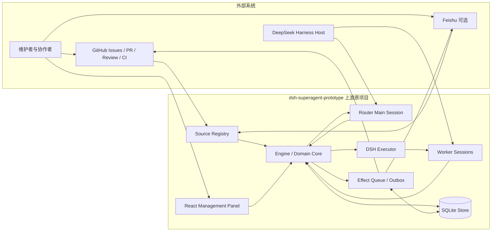
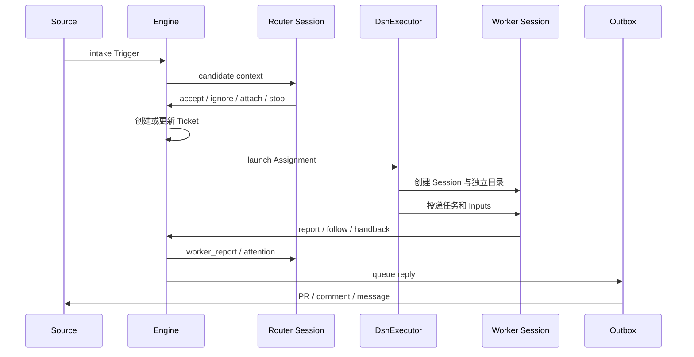
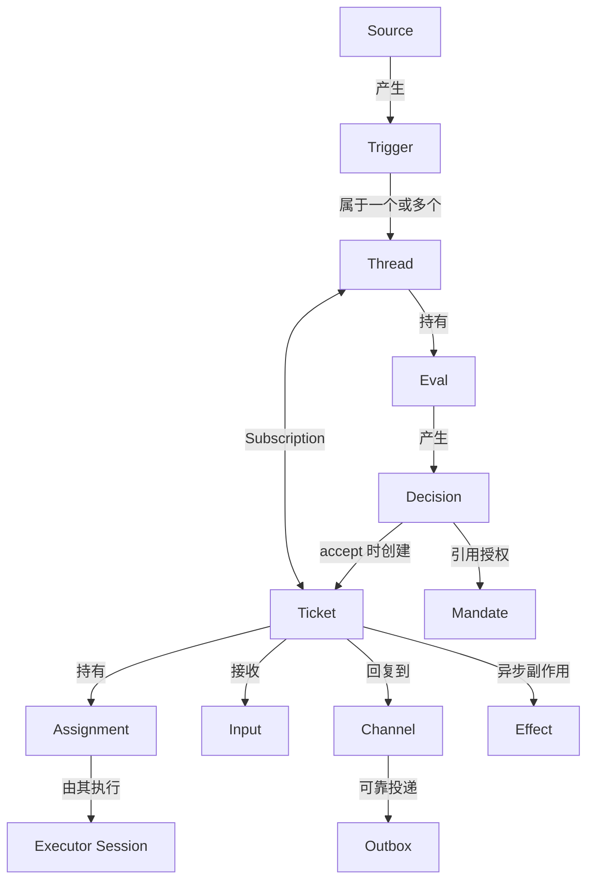
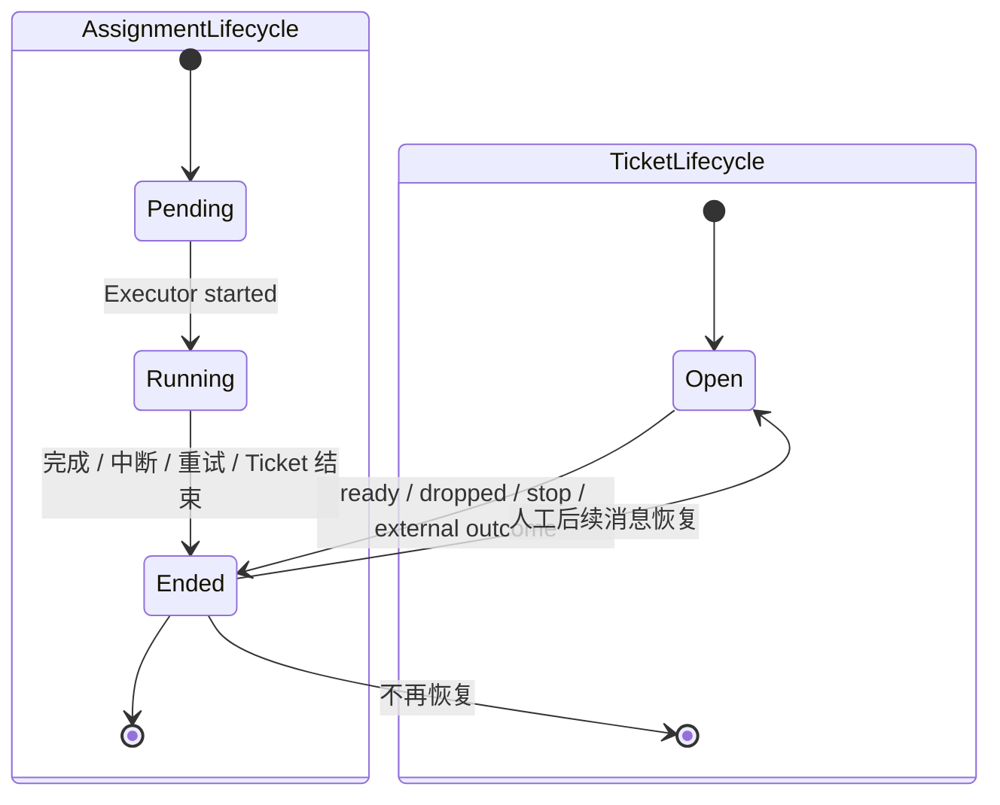

# SuperAgent 原项目架构说明

> 文档对象：deepseek-ai/dsh-superagent-prototype 本地上游代码  
> 文档日期：2026-11-02  
> 本地目录：dsh-superagent-prototype/  
> 说明范围：**本文只描述上游原项目已经存在的架构和能力，不包含本项目预计新增的评测、活动账本、连续活跃看门狗和指标扩展。**  
> 扩展计划：[superagent-control 详细实施计划书](SuperAgent详细实施计划书.md)

## 1. 项目定位

dsh-superagent-prototype 是一个面向单个 GitHub 仓库的主动式代码 Agent 原型。它接收 GitHub 事件，并可选接入 Feishu；Router 判断事件是否形成授权工作，Worker 在独立 Session 和独立目录中执行任务，最终通过 PR、评论或原会话回复交付结果。

它的核心不是普通聊天，而是一个持续运行的事件驱动系统：

- Source 负责监听外部事件。
- Router 负责全局上下文、准入判断和任务路由。
- Engine 维护领域状态和事务一致性。
- Executor 为每个 Ticket 管理独立 Worker Session。
- Effect 与 Outbox 负责持久化副作用和外部交付。
- SQLite 保存领域状态、队列、设置和恢复信息。
- React 管理面板提供状态与配置入口。

上游是研究原型，不应描述成 DeepSeek 官方生产服务，也不应把本项目后续扩展混入其已有能力。

## 2. 系统上下文

### 2.1 上游原项目系统边界

### 2.2 系统责任

| 组件 | 上游已有责任 | 不负责 |
|---|---|---|
| GitHub / Feishu Source | 读取事件、构造 Trigger、维护 Source 游标和原始记录 | 不直接创建 Ticket |
| Router Main Session | 读取候选上下文、调用研判与路由工具、处理 Worker 报告 | 不直接修改任务工作目录 |
| Engine | 单一事务入口，维护 Trigger、Thread、Decision、Ticket、Assignment | 不执行模型和 Shell 工作 |
| DshExecutor | Worker Session、目录、并发槽、Input 投递、停止与恢复 | 不决定准入授权 |
| Worker Session | 在自己的 Ticket 和目录内执行、报告、跟进 PR | 不读取其他 Ticket 的私有上下文 |
| Effect / Outbox | 持久化异步副作用、退避重试、消息投递 | 不改变领域授权 |
| SQLite Store | 保存领域对象、设置、队列和恢复状态 | 不是外部分析仓库 |
| Management Panel | 查看状态、配置、停止、重试和管理 | 不替代 Engine 业务规则 |

## 3. Router–Worker 双层架构

### 3.1 Router

Router 是主 Session，面向整个服务而不是某一个 Ticket。它接收候选事件、Worker 报告和需要人工关注的状态，使用应用工具读取上下文并作出路由操作。

主要职责：

- 获取 Trigger、Thread、相关 Ticket 和 Policy 上下文。
- 对已经通过确定性 Gate 的候选进行模型研判。
- 接受、忽略、停止或把事件附加到既有 Ticket。
- 接收 Worker 报告和 Attention。
- 管理设置、Prompt revision 和 Policy 同步。

Router 的模型行为受 Prompt 约束，但真正的权限、状态转换和资源范围仍由 Host 代码检查。

### 3.2 Worker

每个 Ticket 对应一个固定命名的 Worker Session 和独立工作目录。一个 Ticket 可以因为恢复、重试或交接拥有多个 Assignment，但同一时刻由当前 Assignment 持有执行权。

主要职责：

- 读取自己的 Ticket、输入、关联 Thread 和允许访问的原始 Source 记录。
- 修改代码、运行工具和测试。
- 创建或跟进 PR。
- 报告 progress、waiting、ready、blocked、failed 或 dropped。
- 关注相关 Thread，或把无关/不属于自己的事件交还 Router。

Worker 无权读取其他 Ticket 的完整私有上下文，也不拥有 Router 的全局配置工具。

### 3.3 Router 与 Worker 的协作

## 4. 核心领域模型

### 4.1 对象关系

### 4.2 对象说明

| 对象 | 含义 | 关键约束 |
|---|---|---|
| Source | GitHub、Feishu 等事件来源 | Source 决定原生身份、Thread 和 Channel |
| Trigger | 一次不可变外部事件 | 是审计和幂等处理单位 |
| Thread | Source 原生会话或 Issue/PR 线程 | 同一时间最多一个 Eval；保存 Subscription |
| Policy | 版本化授权规则和 Source 策略 | Policy 变化不直接取消已授权工作 |
| Eval | 对一批 Trigger 的准入判断 | 由 Gate 和模型 Assessment 两层组成 |
| Decision | accept、ignore、stop 或 unavailable 结果 | 保存理由、Policy 版本和审计信息 |
| Mandate | accept 产生的授权范围 | 对 Ticket 不可变；声明谁、为何、以何种范围授权 |
| Ticket | 一项已授权工作 | 生命周期独立于 Executor；可结束后因人工消息恢复 |
| Assignment | Ticket 与一个 Executor 实例的绑定 | pending → running → ended；一个 Ticket 可有多个 |
| Subscription | Ticket 与 Thread 的多对多关系 | 后续事件可以直接扇出到 Ticket |
| Input | 送给 Ticket/Worker 的 Trigger 或文本上下文 | 未交付 Input 保存在 undelivered |
| Channel | 向 Source 回复的地址 | 用于确认、问题、结果和 PR 通知 |
| Effect | 需要异步执行的副作用 | 持久化、合并、限流、退避重试 |
| Outbox | 对外消息的可靠发送记录 | pending / sent / dropped；保证消息 id 不重复 |

### 4.3 Ticket 与 Assignment 的区别

这是理解上游架构最重要的边界：

- Ticket 表示“被授权的一项工作”。
- Assignment 表示“这项工作当前交给哪个 Executor 实例执行”。
- Ticket 可以经历多个 Assignment。
- Worker 失败、重启恢复或人工重试不必创建新 Ticket。
- Ticket 状态不直接跟随 DSH Session 状态。

## 5. 事件准入与路由

### 5.1 处理流程

1. Source 读取外部事件并生成 Trigger。
2. Engine 将 Trigger 保存，并记录其 Thread 与 Disposition。
3. Source Scope 和 Policy Gate 先做确定性过滤。
4. 可研判事件进入 Eval；同一个 Thread 的 Eval 串行运行。
5. Router Assessment 读取上下文并给出 Decision。
6. accept 创建 Ticket 和 Mandate；ignore 只记录决定；stop 停止目标 Ticket；unavailable 表示本次无法可靠判断。
7. 已订阅 Thread 的后续事件可直接扇出为 Ticket Input，不一定再次经过 Eval。

### 5.2 两层准入

| 层级 | 实现位置 | 作用 |
|---|---|---|
| Gate | Host / Policy 代码 | 检查 Source、Actor、规则强度和确定性授权条件 |
| Assessment | Router 模型 | 根据 Trigger、Thread、相关 Ticket 和 Policy 上下文判断是否形成新工作 |

权限规则不应只依赖 Prompt。Prompt 控制模型如何研判，但 Host 仍负责 Schema、Policy、对象可见性和实际状态转换。

### 5.3 Follow-up 与 Subscription

Subscription 让 Ticket 持续接收相关 Thread 的新事件：

- Ticket 起始 Thread 默认相关。
- Worker 可以关注相关 Issue 或 PR Thread 作为上下文。
- 人工在已订阅 Thread 中的后续消息可以到达已有 Ticket。
- 某些后续消息可以恢复已结束但未被人工明确停止的 Ticket。
- Worker 可以放弃无关 Thread 或把不属于自己的 Trigger hand back。

这套设计避免每条 PR Review 或后续评论都创建新 Ticket。

## 6. 执行层

### 6.1 Assignment 启动

Engine 创建 pending Assignment 后，将 launch 写入持久化 Effect 队列。DshExecutor 在并发槽允许时：

1. 为 Ticket 创建或恢复独立工作目录。
2. 执行可选 prepare 命令。
3. 确保 Worker Session 存在。
4. 标记 Assignment running。
5. 投递起始任务和未交付 Inputs。

### 6.2 并发槽

上游通过 maxWorkers 限制同时活跃的 Ticket 数量。WorkerSlots 同时考虑：

- 已运行的 Worker。
- 正在启动的保留槽位。
- 因 Input 唤醒 Worker 时的临时保留。

超过上限的 launch Effect 保留在队列中，等待槽位释放。

### 6.3 Input 投递

新 Input 通过 delivery Effect 送达当前 Assignment。投递前会重新读取 Ticket，确认：

- Ticket 仍然 open。
- Assignment 仍是当前 running Assignment。
- Worker 没有处于后台清理过程。
- Input 尚未被当前 Worker 读取。

投递失败会记录到 Ticket，并由 Effect 机制重试。

### 6.4 Worker 报告

| Report state | 含义 |
|---|---|
| progress | 工作正在进行 |
| waiting | 当前没有更多工作，等待新事件 |
| ready | 结果已准备好；满足跟随 Thread 条件时可结束 Ticket |
| blocked | 需要人工决定或外部条件 |
| failed | 本次执行失败，等待人工处理或重试 |
| dropped | 没有剩余工作 |

报告可以附带需要人工回答的问题。Engine 会校验问题对应的 Trigger 和 Channel，避免向错误会话发送问题。

### 6.5 后台任务

Worker turn 结束后，Shell job 和 subagent 可能仍在运行。上游已有后台工作观察、收集、停止和时限：

- 后台工作仍在运行时可以暂时持有 Worker 槽位。
- Shell job 超过既有限制后会被停止。
- 新 turn、Ticket 结束或 Host shutdown 会触发对应清理。

该能力针对 turn 结束后的后台工作，不等同于本项目计划增加的“前台 turn 连续活跃看门狗”。

## 7. 持久化与可靠性

### 7.1 SQLite

上游使用一个 orchestrator.sqlite 文件。核心表和记录包括：

| 表/区域 | 保存内容 |
|---|---|
| trigger | Trigger 本体和接收时间 |
| disposition | Trigger 被过滤、研判、投递或交还的去向 |
| trigger_thread | Trigger 与 Thread 的关系和时间排序 |
| thread | Subscription、排队 Trigger、当前 Eval、Source 元数据 |
| ticket | Ticket、Mandate、Assignment、Input、Channel 和执行信息 |
| decision | 每个 Thread 的 Decision |
| effect | 异步副作用、尝试次数、错误和下次执行时间 |
| outbox | 外部回复的 pending / sent / dropped 状态 |
| kv | Schema、设置版本、Prompt 版本、Session 历史和 Source 游标 |

Ticket 和 Thread 的部分可查询状态通过 SQLite 生成列和索引加速。Store 只由当前服务进程打开。

### 7.2 Effect Queue

Effect Queue 把需要外部执行或异步处理的动作与领域事务分开：

- 事务内记录 Effect。
- 事务提交后执行 handler。
- 同类 Effect 可按 kind/key 合并。
- 失败使用退避重试。
- handler 有并发限制。
- 重启后未完成 Effect 仍可继续。

典型 Effect 包括 Worker launch、Input delivery、外部 reply 等。

### 7.3 Outbox

Outbox 为每条对外消息保存唯一收据：

- pending：等待 Source 投递。
- sent：已成功发送。
- dropped：因明确原因放弃。

同一消息 id 不会被重复入队。Source 暂不可用或系统暂停时，消息可以等待恢复。

### 7.4 重启恢复

启动时 Executor 会协调现有 Ticket 和 Assignment：

- pending Assignment 重新排队启动。
- running Assignment 根据最后报告和 Input 状态决定保持或重启。
- 未完成 Effect 和 Outbox 消息继续处理。
- Worker Session、后台 job 和 subagent 按现有恢复语义清理或继续。

恢复逻辑以 SQLite 状态为依据，不只依赖进程内 Timer。

## 8. 管理面板与配置

### 8.1 面板

上游 React 管理面板已经提供：

- Overview：问题、需要人工处理的 Ticket、24 小时流量和 Executor 负载。
- Source：事件来源与健康状态。
- Trigger / Thread：事件时间线和研判结果。
- Eval：Decision、理由和不可用状态。
- Execution / Ticket：任务、Assignment、Input、Report 和执行状态。
- Settings：Policy、Eval、Executor、Source 和暂停配置。
- Prompts：Prompt revision、预览和历史。
- Deployment：部署与环境信息。

### 8.2 配置

上游 Executor 配置已经包括：

- Worker 模型。
- maxWorkers。
- 工作目录根路径。
- prepare 命令。
- blockedCommands。

processing pause 独立于 Executor 配置保存，避免暂停操作与其他配置修改产生冲突。

### 8.3 Prompt 与 Policy 版本

- Policy 是授权和准入规则的版本化快照。
- Prompt revision 独立保存，可供 Session 读取历史版本。
- 运行中的对象保留其接受时的授权依据。
- 设置变化通过通知和 Input 传递，不直接撤销所有工作。

## 9. 代码模块地图

| 目录/文件 | 上游职责 |
|---|---|
| src/core/ | Engine、领域模型、Ticket、Assignment、Eval、Thread、Reply |
| src/executor/ | DSH Worker Session、并发槽、后台任务和停止 |
| src/app/runtime.ts | 应用装配与生命周期 |
| src/app/store.ts | SQLite Store 与 Repository |
| src/app/effects.ts | 持久化 Effect Queue |
| src/app/outbox.ts | 外部消息可靠投递 |
| src/app/sessions.ts | Router/Worker Session 管理 |
| src/app/views/ | 管理 API 的服务端视图 |
| src/app/tools/ | Router 与 Worker 可调用工具 |
| src/sources/ | GitHub、Feishu 和 Host Source 接口 |
| src/client/ | React 管理面板 |
| prompts/ | Router、Worker、Admission、团队协作 Prompt |
| skills/ | GitHub 与 Feishu Source 使用说明 |
| tests/ | Core、Runtime、并发、迁移、View、Panel 等测试 |

## 10. 上游已有工程能力

### 10.1 已有能力清单

- 单仓库 GitHub 事件驱动。
- 可选 Feishu Source。
- Router–Worker 双层 Session。
- Policy Gate 与模型准入研判。
- Ticket / Assignment 分离。
- Thread Subscription 和 follow-up 扇出。
- SQLite 持久化。
- Effect Queue 和 Outbox。
- 幂等、退避重试和并发槽。
- processing pause、人工 stop/retry。
- Host 重启恢复。
- Worker 独立目录和工具范围。
- React 管理面板。
- Prompt 与设置版本。
- Vitest 测试体系。

### 10.2 不应误报为本项目贡献

后续写 README、演示或简历时，下列能力必须明确标为上游已有：

- Router–Worker 架构本身。
- Ticket、Assignment、Subscription 和 Mandate 领域模型。
- maxWorkers 并发控制。
- Effect Queue、Outbox、退避重试和消息幂等。
- Worker 独立 Session 与独立目录。
- processing pause、stop/retry 和基础重启恢复。
- 原有 React 管理面板。

## 11. 与扩展项目相关的原始边界

以下不是对上游价值的否定，而是相对于 superagent-control 的“控制面增强”目标仍可补充的工程空间：

| 方向 | 上游当前状态 | 后续扩展空间 |
|---|---|---|
| 准入评测 | 有 Gate、Assessment、Decision 和 Prompt revision | 缺少独立 L1/L2/L3 回归数据集与版本对比报告 |
| 前台执行超时 | 有 prepare、Eval、后台 job 等局部限制 | 缺少面向当前前台 turn 连续占槽的 Host 看门狗 |
| 活跃耗时 | 有 createdAt、startedAt、endedAt、idleAt | 不能准确还原多段真实活跃区间 |
| 整体指标 | 有状态、24 小时流量、running/queued 等概览 | 缺少任务耗时分布、p50/p95 和活动时间线 |
| PR 质量门禁 | Worker 可报告并跟进 PR | Host 侧确定性 Ready 预检查可进一步增强 |

这些扩展的详细设计、测试和排期不属于本文范围，见：

- [项目设计预想](项目设计预想.md)
- [SuperAgent 详细实施计划书](SuperAgent详细实施计划书.md)

## 12. 推荐阅读顺序

1. 先读本文第 1～4 节，理解上游定位、Router–Worker 和领域对象。
2. 再读第 5～8 节，理解准入、执行、持久化和管理面板。
3. 查看上游 docs/001-domain.md、docs/003-execution.md 和 docs/007-architecture.md 获取代码级细节。
4. 最后阅读扩展计划书，比较上游已有能力与本项目预计新增模块。

按此顺序阅读，可以清楚地区分“我理解并复用的上游系统”与“我计划设计和实现的二次开发贡献”。
