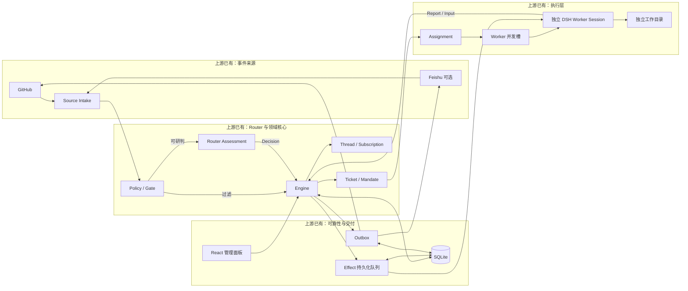
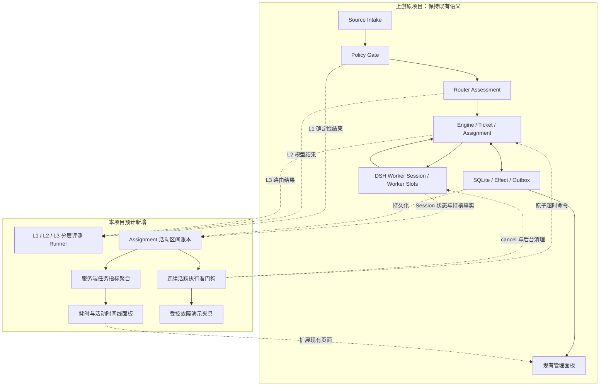
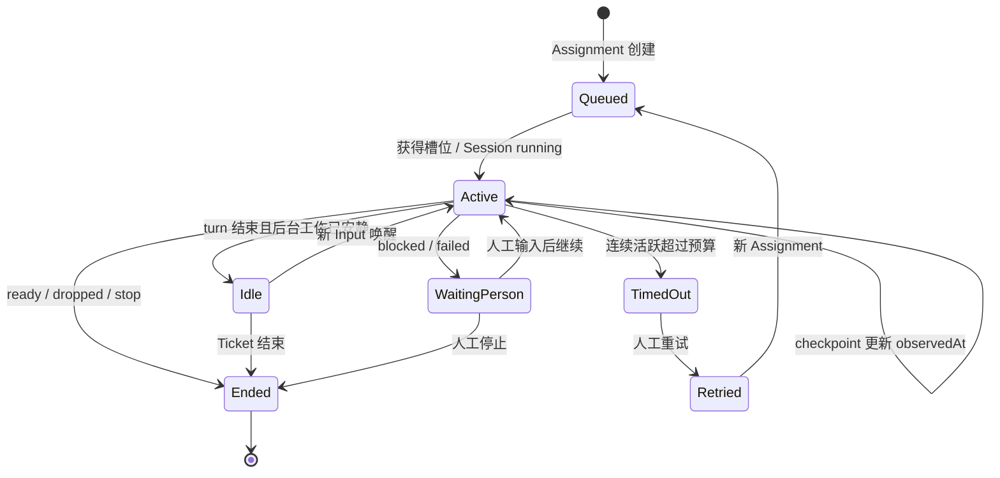
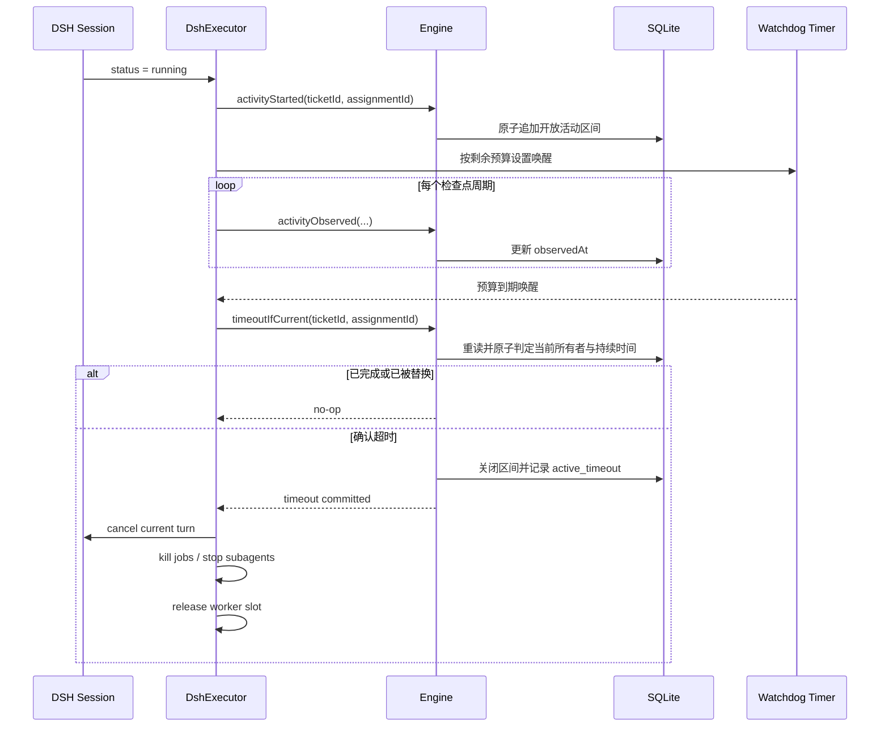
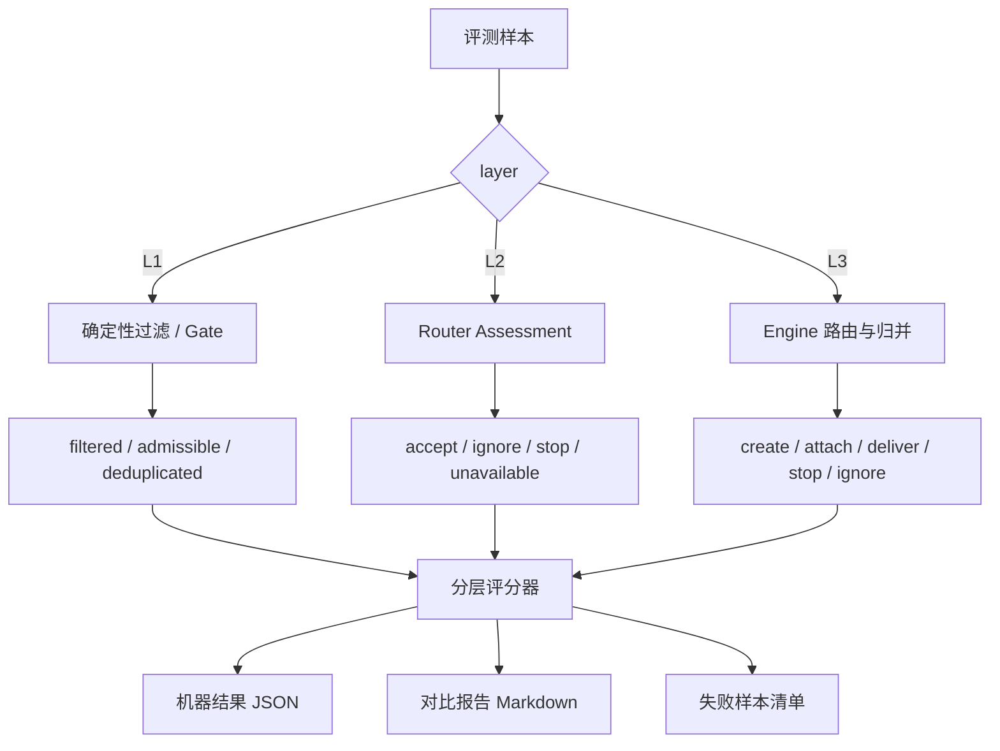
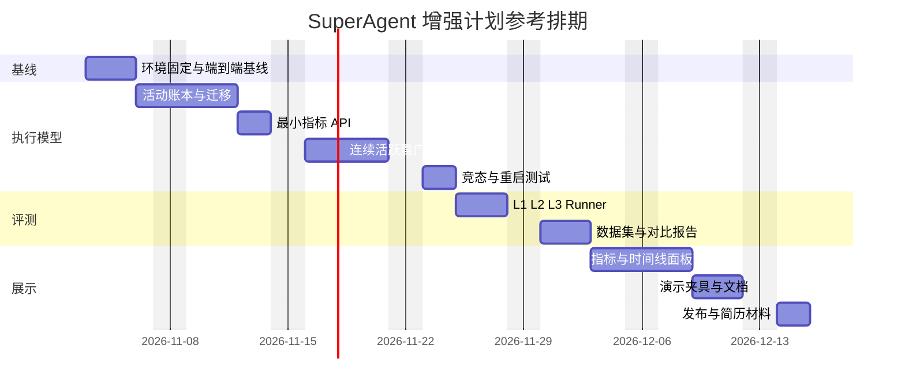
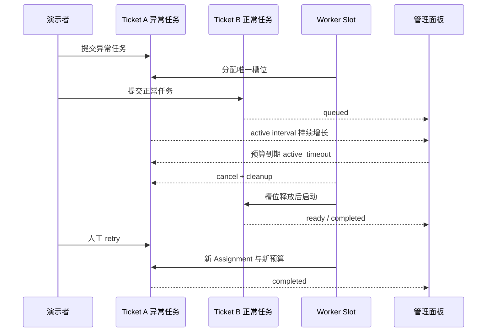

# 详细实施计划书：superagent-control（SuperAgent 控制面增强）

> 版本：v1.0  
> 项目名：superagent-control  
> 日期：2026-11-02  
> 关联设计：[项目设计预想](项目设计预想.md)  
> 上游架构：[SuperAgent 原项目架构说明](SuperAgent原项目架构说明.md)  
> 上游代码：dsh-superagent-prototype/  
> 计划周期：约 28～30 个有效开发日；下文日历按 2026-11-03 启动、工作日连续投入估算  

## 1. 执行摘要

本项目不重写 Agent 框架，而是在上游 Router–Worker 架构上补齐三类工程能力：

1. **准入行为可评测**：把确定性过滤、模型研判和端到端路由拆成 L1/L2/L3 三层，建立可重复运行、可对比 Prompt revision 的回归体系。
2. **连续执行可控制**：以 Worker 实际持有并发槽的连续活跃区间为计时事实，在 Host 侧实现可关闭、可恢复、幂等的执行看门狗。
3. **任务流转可观测**：使用持久化活动区间计算真实活跃耗时，并展示排队、执行、结束、重试、恢复和超时的统一时间线。

项目最终不是以“功能数量”验收，而是以三组证据验收：

- 一次受控故障实验能证明异常 turn 被停止、并发槽被释放、排队任务继续启动。
- 一份分层评测报告能证明 Prompt 修改造成了什么变化、改善了哪些类别、引入了哪些回归。
- 一套自动化测试能证明正常完成、停止、超时、重试、重启和竞态场景保持既有语义。

## 2. 项目目标与成功标准

### 2.1 核心目标

| 目标 | 成功标准 | 证据 |
|---|---|---|
| 行为可评测 | L1/L2/L3 分层运行；可比较两个 Prompt revision | JSON 结果、Markdown 报告、失败案例 |
| 执行可控制 | 连续占槽超过预算后自动停止；重复触发无重复副作用 | 领域测试、运行时并发测试、演示录像或日志 |
| 指标可信 | 活跃耗时来自活动区间，不用 startedAt 到 endedAt 近似 | 数据库记录、指标测试、任务详情时间线 |
| 上游兼容 | 默认关闭看门狗，不改变现有部署默认行为 | 配置默认值、回归测试、迁移测试 |
| 可演示 | 10 分钟内完成一条端到端故事线 | 演示脚本、固定夹具、备用录屏 |

### 2.2 非目标

- 不做通用多 Agent 编排平台。
- 不做 Docker/VM 级隔离。
- 不用命令黑名单包装成完整安全边界。
- 不把合成评测集结论外推成生产准确率。
- 不在首版实现跨多个 turn 的累计 Assignment 成本预算。
- 不在首版引入 Prometheus、OpenTelemetry 或外部时序数据库。
- 不在核心闭环完成前实现 PR 自动合并门禁。

### 2.3 Go/No-Go 条件

阶段 0 结束时必须满足以下条件，否则暂停功能开发，先解决环境问题：

- pnpm install --frozen-lockfile 成功。
- pnpm check 全部通过。
- 能使用独立 stateDir 启动服务。
- 至少跑通一次 Trigger → Eval → Ticket → Assignment → Report。
- 已记录 Node、pnpm、DSH、操作系统和依赖版本。

## 3. 上游原项目与本项目扩展

本节固定按“先看上游原项目，再看本项目扩展”的顺序阅读。标记为“上游已有”的能力已经存在于 dsh-superagent-prototype；标记为“本项目预计新增”的模块仍属于计划，不能作为当前已实现能力描述。

更完整的上游说明见：[SuperAgent 原项目架构说明](SuperAgent原项目架构说明.md)。

### 3.1 上游 SuperAgent 原项目架构

下图只展示上游已有能力，不包含活动账本、连续活跃看门狗、任务指标扩展或离线评测 Runner。



上游原项目已经完成：

- GitHub 与可选 Feishu 事件接入。
- Policy Gate 与模型研判。
- Trigger、Thread、Decision、Ticket、Assignment、Subscription 等领域对象。
- Router–Worker 双层 Session、每 Ticket 独立目录和 Worker 并发槽。
- Effect 持久化队列、Outbox、重试、幂等、暂停/恢复与重启恢复。
- Worker 报告、PR/评论回复和 React 管理面板。

### 3.2 本项目预计扩展架构

下图以“上游保持不变”为底座，只把本项目新增模块放在独立区域，并用虚线表示它们读取或增强上游能力。



### 3.3 前后能力对照

| 关注点 | 上游原项目已有 | 本项目预计新增 | 边界说明 |
|---|---|---|---|
| 准入 | Policy Gate、Router Assessment、Decision 持久化 | L1/L2/L3 数据集、Runner、评分与版本对比报告 | 不重写 Router，只增加离线评测能力 |
| 并发 | maxWorkers、WorkerSlots、launch/delivery Effect | 连续占槽预算与 Watchdog Timer | 不重复实现并发控制 |
| 后台任务 | 空闲后的后台任务限制、job/subagent 清理 | 前台 turn 连续活跃超时 | 两类超时对象不同 |
| 恢复 | Assignment 中断恢复、Session 恢复、Effect 重试 | 活动区间检查点与超时恢复语义 | 沿用上游恢复流程 |
| 持久化 | SQLite 保存 Ticket、Decision、Effect、Outbox 等 | Assignment 活动区间和结构化 timeout 事实 | 首版扩展聚合，不引入外部数据库 |
| 可观测性 | 状态页、任务详情、运行/排队计数 | 真实活跃耗时、p50/p95、时间线和超时统计 | 不把 startedAt 到 endedAt 冒充活跃耗时 |
| 安全 | Policy 授权、工具范围、命令限制等基础边界 | 可选 PR Ready 预检查 | 不宣称完整沙箱或不可绕过的合并边界 |

### 3.4 改造代码锚点

| 位置 | 上游当前职责 | 本项目计划改动 | 状态 |
|---|---|---|---|
| dsh-superagent-prototype/src/core/model.ts | Ticket / Assignment 领域模型 | 增加活动区间和结构化超时信息 | 预计新增 |
| dsh-superagent-prototype/src/core/assignments.ts | Assignment 生命周期事实 | 增加 activity start/checkpoint/end/timeout 命令 | 预计新增 |
| dsh-superagent-prototype/src/executor/dsh.ts | Worker Session、并发槽、停止与恢复 | 统一“是否持槽”判断，驱动活动记录和看门狗 | 预计新增 |
| dsh-superagent-prototype/src/policy.ts | Executor 配置 Schema | 增加可空的连续活跃预算 | 预计新增 |
| dsh-superagent-prototype/src/app/migration.ts | SQLite Schema 迁移 | 升级存量 Assignment JSON | 预计新增 |
| dsh-superagent-prototype/src/app/views/overview.ts | 原有概览数据 | 增加任务流转指标摘要 | 预计新增 |
| dsh-superagent-prototype/src/app/views/tickets.ts | 原有 Ticket 视图 | 增加耗时和活动时间线 | 预计新增 |
| dsh-superagent-prototype/src/client/ | 原有管理面板 | 增加指标与时间线展示 | 预计新增 |

## 4. 本项目预计新增：统一计时模型

### 4.1 为什么不能直接使用现有时间戳

现有 Assignment 已有 createdAt、startedAt、endedAt、deliveredAt 和 idleAt，但它们只能描述少数关键时刻，无法还原多轮 Worker 活动：

- startedAt 到 endedAt 会包含空闲、等待人工和服务离线时间。
- idleAt 只保留最近一次空闲时刻，无法累计多个 turn。
- Assignment state 为 running 不等于 Worker 正在占用并发槽。
- 全局 paused 只会阻止部分新工作，不保证正在运行的 Worker 已停止。

因此本计划把“是否实际持有并发槽”作为活跃时间的唯一事实来源。

### 4.2 术语与口径

| 术语 | 定义 | 是否计入活跃耗时 |
|---|---|---|
| queued | Assignment 已创建，尚未获得 Worker 槽位 | 否 |
| active | Worker Session 为 running 或 settling，并实际持有槽位 | 是 |
| idle | Worker turn 已结束，Session 没有前台执行或受控后台收尾 | 否 |
| waiting-person | Worker 报告 blocked / failed，等待人工处理 | 否 |
| processing-paused | 系统暂停接收或分派新工作 | 取决于 Worker 是否仍 active |
| offline | 服务未运行 | 否 |
| timed-out | 当前连续 active 区间超过预算 | 到最近有效停止时刻为止 |

### 4.3 建议数据结构

首版把活动区间保存在 Assignment 聚合中，避免领域状态和独立指标表双写。真实数据证明增长过快后，再考虑迁移到只追加事件表。

```ts
type ActivityEndReason =
  | 'idle'
  | 'waiting'
  | 'completed'
  | 'stopped'
  | 'timed-out'
  | 'host-restart'

interface AssignmentActivityInterval {
  id: string
  startedAt: string
  observedAt: string
  endedAt?: string
  endReason?: ActivityEndReason
}

interface AssignmentTimeout {
  kind: 'continuous-active'
  at: string
  budgetMs: number
  activeMs: number
  reasonCode: 'active_timeout'
}

interface Assignment {
  // 原有字段保持不变
  activity?: AssignmentActivityInterval[]
  timeout?: AssignmentTimeout
}
```

约束：

- 一个 Assignment 同时最多存在一个没有 endedAt 的开放区间。
- observedAt 每 30 秒左右更新一次；该周期先作为内部常量，不暴露为用户配置。
- 正常状态切换时 endedAt 使用真实切换时刻，并与 observedAt 一起落库。
- 非正常崩溃恢复时，遗留开放区间以 observedAt 关闭并标记 host-restart，因此最多损失一个检查点周期的计时，不把离线时长计入。
- 活动区间和 Assignment 状态在同一个 Repository 原子事务中更新。

### 4.4 生命周期图



注意：图中的 WaitingPerson 是 Ticket/报告语义，Assignment 是否结束以最终实现遵循上游现有 retry 约束为准；超时必须让当前 Assignment 不再拥有执行权，晚到报告不得覆盖新 Assignment。

### 4.5 指标公式

| 指标 | 公式 | 数据来源 |
|---|---|---|
| 首次排队耗时 | firstAssignment.startedAt - ticket.createdAt | 现有时间戳 |
| 累计排队耗时 | 每个 Assignment 的 startedAt - createdAt 之和 | 现有时间戳 |
| 活跃执行耗时 | 所有已闭合 activity interval 的 endedAt - startedAt 之和 | 新活动区间 |
| 总完成耗时 | ticket.ended.at - ticket.createdAt | 现有时间戳 |
| 人工重试次数 | endedReason 为 manual retry 的 Assignment 数量 | 结构化结束原因 |
| 恢复次数 | endedReason 为 host restart 的 Assignment 数量 | 结构化结束原因 |
| 超时次数 | timeout 存在的 Assignment 数量 | 新超时记录 |
| 成功率 | completed Ticket / 已结束 Ticket | Ticket outcome |
| p50 / p95 | 对已完成任务的完成耗时使用最近秩法 | 服务端聚合 |

p95 默认至少需要 20 个有效样本；不足时显示样本数和“样本不足”，不显示看似精确的百分位。

## 5. 本项目预计新增：连续活跃执行看门狗

### 5.1 配置

计划在 Executor 配置中加入：

| 配置 | 类型 | 默认值 | 建议范围 | 含义 |
|---|---|---|---|---|
| maxContinuousActiveMinutes | number 或 null | null | 1～1440 分钟 | null 表示关闭；限制单个连续占槽区间 |

保持默认关闭，保证升级后的现有部署行为不变。测试使用 Fake Clock，不通过真实等待验证。

### 5.2 工作流程



### 5.3 幂等与竞态规则

1. timeoutIfCurrent 必须同时校验 ticketId、assignmentId、Assignment state 和当前开放区间 id。
2. 正常完成与超时竞争时，先提交事务的一方获胜。
3. 若正常完成先提交，超时命令返回 no-op。
4. 若超时先提交，晚到报告按 assignmentEnded 或非当前 Assignment 拒绝。
5. Session cancel、job kill 和 subagent stop 必须允许重复调用。
6. 领域状态只转换一次；清理失败记录到 health / Effect 并重试，不回滚已确认的超时事实。
7. 新 Assignment 创建后，旧 Timer 即使触发也不能停止新 Worker。

### 5.4 重启语义

- 正常关机：关闭当前活动区间，然后执行现有 shutdown 清理。
- 非正常崩溃：恢复时用 observedAt 关闭遗留开放区间，endReason = host-restart。
- 服务离线时间不计入活跃耗时。
- 上游若为中断任务创建新 Assignment，新 Assignment 获得独立预算。
- 若恢复后没有 Worker 实际运行，不设置 Timer。

### 5.5 计划实现单元

| 单元 | 责任 |
|---|---|
| holdsWorkerSlot(status) | 统一并发槽和计时对 running / settling 的判断 |
| Assignment activity commands | 创建、检查点、关闭活动区间 |
| Watchdog registry | 每个活跃 Assignment 一个可重建 Timer |
| timeoutIfCurrent | Core 原子判定与结构化超时状态 |
| cleanup path | 取消 turn、停止后台任务、释放槽位 |
| recovery reconciliation | 启动时关闭遗留区间并恢复现有 Assignment 语义 |

## 6. 本项目预计新增：分层准入评测

### 6.1 分层关系



### 6.2 数据集组织

建议目录：

```text
evals/
  admission/
    schema.ts
    datasets/
      dev.json
      holdout.json
    runner.ts
    scorers.ts
    compare.ts
    reports/
      .gitkeep
```

建议样本结构：

```json
{
  "schemaVersion": 1,
  "id": "l2-zh-accept-001",
  "split": "dev",
  "layer": "L2",
  "locale": "zh-CN",
  "source": "github",
  "actor": { "kind": "person", "allowed": true },
  "threadContext": [],
  "triggerContent": "请修复这个可稳定复现的空指针问题。",
  "expectedOutcome": "accept",
  "expectedReasonCodes": ["authorized", "actionable"],
  "risk": "normal",
  "tags": ["bug", "explicit-request"]
}
```

### 6.3 数据集规则

- 首版至少 80 条：约 60 条开发集、20 条冻结留出集。
- 中英文、Source、风险等级和结果类别尽量均衡。
- 一个样本只声明一个主要评测层级，避免结果归因不清。
- 结构化原因使用原因码集合包含关系评分，不比较自然语言措辞。
- 留出集不在日常开发命令中默认执行。
- Prompt 调整后先运行开发集；阶段报告才运行留出集。
- 每次报告保存数据集哈希、Prompt 哈希、Policy 哈希、模型标识、参数和运行时间。

### 6.4 指标

| 层级 | 必选指标 | 补充指标 |
|---|---|---|
| L1 | exact match、规则覆盖率 | 每条规则失败样本 |
| L2 | Accept Precision、Recall、Macro-F1、False Accept Rate | 高风险 FAR、错误忽略率、三次运行一致性 |
| L3 | 路由正确率、重复 Ticket 率、错误投递率 | 按事件类型和 Source 分组 |

L2 正式报告对冻结留出集运行三次，报告均值、最小值、最大值和逐样本一致率。温度设为 0 只能降低随机性，报告不得声称在线模型完全确定。

### 6.5 计划命令

以下命令是实现目标，不代表当前已经存在：

```powershell
pnpm eval:admission -- --split dev --prompt-revision current
pnpm eval:admission -- --split holdout --runs 3 --prompt-revision 12
pnpm eval:admission:compare -- --baseline 11 --candidate 12
```

真实模型评测：

- 使用独立临时 stateDir。
- 禁用真实 Source 写操作。
- 不进入普通 pnpm test。
- 网络失败、限流和模型不可用标记为 infrastructure error，不算成模型错误，也不能静默忽略。

## 7. 本项目预计新增：可观测性与面板扩展

### 7.1 服务端先行

所有指标口径在服务端 View 中计算，React 只展示结果。这样 CLI、API 和面板使用同一份定义，避免前端二次计算造成漂移。

建议新增视图：

- GET metrics/summary：窗口内的成功率、失败率、超时数、p50/p95、样本数。
- GET metrics/tickets：Ticket 级排队、活跃、总耗时和计数。
- GET tickets/:id/activity：Assignment 活动区间和关键状态时间线。

如果保持现有路由命名习惯需要调整，以现有 HTTP 模块的风格为准，不强制照搬路径。

### 7.2 页面信息架构

概览页只展示：

- 当前 running / maxWorkers。
- queued、timed-out、waiting-person 数量。
- 最近窗口的成功率、p50 和达到样本阈值后的 p95。

任务列表增加：

- 首次排队耗时。
- 累计活跃耗时。
- 总完成耗时。
- 人工重试、恢复和超时次数。

任务详情增加：

- Ticket 创建、Assignment 排队、active、idle、waiting、timeout、retry、ended 时间线。
- 每个 Activity interval 的开始、结束、持续时间和结束原因。
- 超时诊断信息和对应 Assignment id。

### 7.3 小样本和空状态

- 样本数为 0：显示“暂无已完成任务”。
- 样本数小于 20：显示 p50 和 n，不显示 p95。
- 进行中区间：显示“进行中”，耗时最多按最近 observedAt 计算，并标注检查点时间。
- 旧数据库任务没有活动区间：活跃耗时显示“不可用”，不能回填 startedAt 到 endedAt 的估算值。

## 8. 本项目实施工作分解

### 阶段 0：基线与环境固定，2～3 日

任务：

- 安装依赖并运行 pnpm check。
- 建立独立开发 stateDir。
- 跑通最小端到端链路。
- 保存验证环境和基线日志。
- 增加 Node 22/24 GitHub Actions。

交付物：

- docs/baseline.md。
- CI 工作流。
- 一份未修改功能前的测试结果。

退出条件：

- Go/No-Go 条件全部满足。

### 阶段 1：活动账本与最小指标，5 日

任务：

- 定义 AssignmentActivityInterval 与不变量。
- 增加 Schema 迁移和旧数据兼容。
- 从 Worker status 事件驱动 start/checkpoint/end。
- 使用 Fake Clock 测试多段活动累计。
- 实现服务端指标聚合和最小 JSON/表格入口。

交付物：

- 活动区间领域模型。
- 迁移测试。
- activity / metrics 单元测试。
- API 返回示例。

退出条件：

- 同一测试任务经历两次 active 和一次 idle 后，累计活跃耗时精确匹配 Fake Clock。
- 旧任务没有活动记录时显示不可用而非错误估算。

### 阶段 2：连续活跃看门狗，6～7 日

任务：

- 增加 maxContinuousActiveMinutes 配置。
- 实现 Timer registry 和启动恢复。
- 实现 timeoutIfCurrent 原子命令。
- 复用现有 stopBackground / cancel 路径。
- 覆盖正常完成与超时、停止与超时、旧 Timer 与新 Assignment 的竞态。

交付物：

- 可关闭的看门狗。
- 结构化 active_timeout 记录。
- 运行时并发与恢复测试。

退出条件：

- 超时后槽位释放且 queued Ticket 能启动。
- 重复超时与重复清理没有重复副作用。
- 服务离线时间不计入活动区间。

### 阶段 3：L1/L2/L3 准入评测，5～6 日

任务：

- 定义样本 Schema 和校验器。
- 建立 60 条开发集和 20 条留出集。
- 实现 L1/L3 本地确定性 runner。
- 实现 L2 独立真实模型 runner。
- 实现评分、对比报告和失败样本输出。

交付物：

- 版本化数据集。
- JSON 结果和 Markdown 报告。
- 至少两个 Prompt revision 的对比。

退出条件：

- 报告能明确指出改善、回归和不一致样本。
- 留出集不会被默认开发命令执行。

### 阶段 4：面板与演示闭环，5 日

任务：

- 概览指标、任务列表耗时、任务详情时间线。
- 中英文文案。
- 空数据、小样本、旧数据和进行中状态。
- 受控超时演示夹具。
- 演示脚本、架构图和备用录像。

交付物：

- 完整管理面板。
- 10 分钟演示脚本。
- 前后对比截图或录像。

退出条件：

- 面板数值与测试数据库一致。
- 演示可在全新临时 stateDir 重复运行。

### 阶段 5：发布与简历材料，2～3 日

任务：

- 全量 pnpm check。
- 更新 README、架构文档和配置说明。
- 整理提交历史与变更清单。
- 将真实样本数、指标和故障实验数据填入简历。

交付物：

- 最终文档。
- 可复现命令。
- 简历项目描述和面试问答提纲。

## 9. 参考进度图



如果是业余时间开发，建议保持任务顺序不变，将日历周期放大到 7～9 周；不要并行展开面板和评测数据集，以免同时出现两个未闭环分支。

## 10. 测试计划

### 10.1 测试分层

| 层级 | 范围 | 原则 |
|---|---|---|
| 领域单元测试 | 活动区间、超时原子命令、指标公式 | Fake Clock、无网络、确定性 |
| Repository / Migration | 旧数据库升级、字段持久化 | 真实 SQLite 临时库 |
| Executor 集成测试 | status 事件、Timer、cancel、slot | 模拟 DSH Host |
| Runtime 并发测试 | 完成/超时、停止/超时、重试竞态 | 精确控制 Promise 栅栏 |
| Panel 测试 | 空数据、小样本、旧数据、时间线 | Fake 管理 API |
| 模型评测 | L2 Prompt 行为 | 独立命令，不进入 CI 硬门禁 |

### 10.2 必测用例矩阵

| 编号 | 场景 | 期望 |
|---|---|---|
| A01 | queued 尚未启动 | 无活动区间，不计时 |
| A02 | running → idle | 生成一个闭合区间 |
| A03 | idle → running → idle | 两个区间正确累计 |
| A04 | processing paused，但 Session 仍 running | 继续计时 |
| A05 | waiting-person | 不新增活动时间 |
| A06 | 检查点后进程崩溃 | 恢复时关闭到 observedAt，不计算离线时间 |
| W01 | 配置为 null | 不创建看门狗 Timer |
| W02 | 正常完成早于预算 | Timer 清除，任务正常完成 |
| W03 | 预算到期 | 记录 active_timeout、取消 Worker、释放槽位 |
| W04 | timeout 与 ready 同时发生 | 仅一个事务获胜 |
| W05 | timeout 与人工 stop 同时发生 | 无重复清理和副作用 |
| W06 | 旧 Timer 在 retry 后触发 | 不影响新 Assignment |
| W07 | 清理第一次失败 | 领域超时不回滚，清理可重试 |
| M01 | 无已完成任务 | 指标返回空状态 |
| M02 | 小于 20 个样本 | 不返回或不展示 p95 |
| M03 | 旧任务无 activity | active duration 为 unavailable |
| E01 | L1 未授权用户 | 精确 filtered |
| E02 | L2 高风险误接受 | 计入 high-risk FAR |
| E03 | L3 重复事件 | 不创建重复 Ticket |
| E04 | 模型 API 失败 | 标记 infrastructure error |

### 10.3 质量门禁

每个阶段合并前：

- pnpm typecheck。
- 相关 Vitest 测试。
- pnpm build。
- docs/007-architecture.md 同步更新。
- 新增 class 具备紧邻 JSDoc。
- 中英文文案同时更新。
- 不依赖真实时间等待的测试不使用 sleep。

最终发布前运行完整 pnpm check，并在 Node 22/24 CI 矩阵中通过。

## 11. 受控演示方案

### 11.1 演示配置

- maxWorkers = 1，保证槽位释放效果清晰。
- maxContinuousActiveMinutes = 1。
- 使用独立临时 stateDir 和演示仓库。
- Ticket A 使用故障夹具制造持续前台执行。
- Ticket B 是可快速完成的普通任务，在 A 后进入队列。

### 11.2 演示时间线



### 11.3 演示证据

面板和日志至少显示：

- A 的 Assignment id、预算、实际活跃时长和 active_timeout。
- B 的排队开始时间与 A 超时后的启动时间。
- A 超时前后 running / queued 计数变化。
- Retry 产生的新 Assignment id。
- A、B 的活动时间线。
- 同一版本的准入评测摘要和一个失败案例。

## 12. 风险、缓解与降级方案

| 风险 | 影响 | 缓解 | 降级方案 |
|---|---|---|---|
| DSH alpha API 变化 | status / cancel 接口不稳定 | 锁定版本、记录环境、适配集中在 Executor | 用固定版本完成演示 |
| Windows/tmux 环境不稳定 | 无法稳定跑端到端 | 阶段 0 提前验证，优先准备 WSL/Linux | 使用录屏并现场展示测试 |
| 活动记录增长 | Ticket JSON 变大 | 先测真实 turn 数量，限制无意义 checkpoint 记录 | 迁移到只追加事件表 |
| SQLite 高频写 | 多 Worker 检查点增加写入 | 30 秒检查点、仅 active Worker 写、批量/去重 | 延长周期并声明误差上限 |
| 超时误伤正常长任务 | 用户体验下降 | 默认关闭、预算可配置、显示剩余时间 | 只在演示/特定环境开启 |
| 模型评测波动 | 结果不可比较 | 三次运行、完整 manifest、留出集 | 报告分布，不声明单点结论 |
| 合成样本偏差 | 指标代表性不足 | 分类覆盖、失败复盘、说明边界 | 将其定位为回归集 |
| 面板吞噬工期 | 核心能力未闭环 | 服务端和测试先行，UI 最后 | 交付 JSON/Markdown 报告 |

## 13. 提交与分支策略

建议每个阶段保持可独立审查：

1. baseline-ci：只增加 CI 与基线文档。
2. assignment-activity-model：领域模型、迁移和单元测试。
3. assignment-activity-runtime：Executor 事件与检查点。
4. active-watchdog：配置、Timer、超时命令和清理。
5. task-metrics-api：聚合与管理 API。
6. admission-evals：Schema、Runner、数据集和报告。
7. metrics-panel：面板、文案和前端测试。
8. demo-docs：演示夹具、架构文档和最终说明。

每个提交只包含一个主要行为变化，避免把 Schema、运行时、UI 和数据集一次性混在同一个巨大提交中。

## 14. Definition of Done

项目达到以下条件才算完成：

- [ ] 全新环境可按文档完成安装和启动。
- [ ] Node 22/24 CI 的 pnpm check 通过。
- [ ] 活动区间具有迁移、领域和运行时测试。
- [ ] 看门狗默认关闭，开启后能在受控故障中释放槽位。
- [ ] 正常完成、停止、超时、重试和重启竞态均有测试。
- [ ] 指标 API 与面板使用同一服务端口径。
- [ ] 旧数据、小样本、空数据和进行中任务展示正确。
- [ ] L1/L2/L3 数据集和 Runner 可独立运行。
- [ ] 至少完成两个 Prompt revision 的开发集对比。
- [ ] 冻结留出集完成三次运行并记录波动。
- [ ] README、配置说明和 docs/007-architecture.md 已同步。
- [ ] 10 分钟演示可以在独立 stateDir 重复完成。
- [ ] 简历中的样本数、耗时和改进比例全部来自真实报告。

## 15. 最终交付清单

| 类别 | 交付物 |
|---|---|
| 代码 | 活动账本、看门狗、指标 API、管理面板、评测 Runner |
| 数据 | 版本化开发集与冻结留出集 |
| 测试 | 领域、迁移、Executor、并发、View、Panel 测试 |
| 报告 | Prompt revision 对比、失败案例、受控故障实验 |
| 文档 | README、架构说明、配置说明、演示脚本 |
| 展示 | 架构图、状态图、时间线、面板截图或录屏 |
| 简历 | 基于真实数据的四条项目描述和面试复盘材料 |

## 16. 简历证据模板

最终只填写真实结果：

> 基于 DeepSeek DSH SuperAgent 的 Router–Worker 架构，构建 N 条中英文分层准入回归集，将确定性过滤、模型研判与端到端路由拆分评估；通过冻结留出集比较两个 Prompt revision，使高风险误接受率由 A 降至 B，同时 Accept Recall 从 C 变化至 D。
>
> 设计 Host 侧 Worker 连续活跃执行看门狗，以 SQLite 持久化活动区间作为统一时间事实，处理完成/超时、停止/超时、重试和重启竞态；在受控故障中于预算到期后 X 秒内释放并发槽，使排队任务恢复启动。
>
> 实现排队、真实活跃执行、总完成耗时及 p50/p95 服务端聚合，并在 React 面板展示 Assignment 时间线；补充 Vitest、Schema 迁移和 Node 22/24 GitHub Actions。

所有 A、B、C、D、N、X 必须来自保存的 JSON 结果、测试或演示记录。
