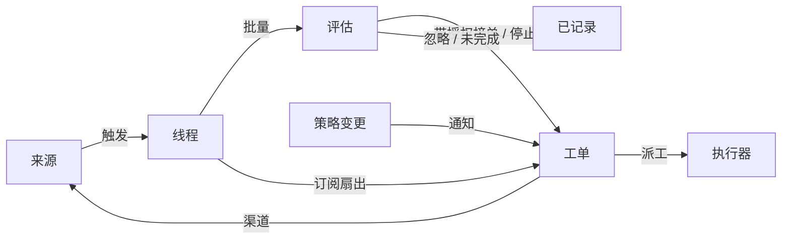

# 001 领域模型（Domain model）

> 本文为中文译本，内容以英文原文为准：[原文](001-domain.md)。

本文命名 dsh-superagent 的概念，以及每个概念所遵守的规则。代码、智能体调用的工具、面板和其他文档都使用这些术语，不使用其他术语。遵循[000 理念](000-philosophy.zh-CN.md)，模型只包含工作所需的概念，业务需求会成为其中某个概念的属性。

## 流程

工作从触发流向评估，再流向执行。来源产生触发。一个触发作为上下文扇出到订阅其线程的工单。以这种方式到达工单的人的消息留在该工单；其他每个触发都进入评估，由评估决定是否请求新工作。评估接单时，会创建一个带有授权的工单。派工把工单交给执行器，结果通过渠道回送到来源。

## 概念

来源、线程、评估、授权和订阅构成核心领域；其余概念为它们提供支撑。

| 概念 | 定义 | 遵守的规则 | 存在原因 |
| --- | --- | --- | --- |
| 来源 | 事件流。来源类型是可复用的实现；来源实例是某个类型的一份配置：是否运行以及监听什么 | 保存读取位置和自身的机器人身份。定义什么算作事件，包括仅随时间成立的条件。在进入领域之前，丢弃机器人自己的消息以及监听范围之外的触发。把每个触发转换为它所属的线程以及用于回复的渠道地址 | 重启不得重放事件 |
| 触发 | 一个不可变事件，带有来源自身的元数据，例如其发起者 | 属于一个或多个线程。同一触发被接单两次只产生一个工单 | 审计与幂等的单位 |
| 线程 | 按时间排列的触发；由来源定义哪些触发构成一个线程 | 同一时间最多有一个评估在其上运行。它可以有多个工单。它持有自己的订阅、正在运行的评估及其决定历史 | 为评估提供一致的视图及其上下文 |
| 关联 | 一个触发所属各线程之间的关系 | 只补充上下文，从不路由 | 让评估能够追踪相关证据 |
| 渠道 | 线程的写入侧；其地址由来源定义 | 一个线程可以有多个渠道；一个工单持有一组渠道 | 确认、回复、PR 和已解决的评审都是写入 |
| 策略 | 带版本的研判规则，以及每个来源各自的部分：谁可以通过该来源、以该来源自身的身份发起工作，列表如何同步，以及哪些机器人可以产生候选 | 策略版本涵盖规则、接单模式和来源部分。影响在途工单的变更（例如其所依据规则的变更）会投递到该工单的派工；它不会撤销授权。不同来源上的身份从不互相映射 | 规则变更时，正在运行的评估必须被丢弃 |
| 评估 | 对一批触发的判断，分为两层：准入和研判 | 输入：触发批次、线程快照、该线程上的所有工单（包括已结束的）以及当前策略。输出：决定。不持有状态 | 决定新工作是启动、继续还是停止 |
| 授权 | 接单所授予的内容：策略版本、范围、强度、匹配的规则、发送者在该来源上的身份，以及来源接收该触发的方式 | 不可变；范围更宽即意味着新工单。工单结束并不会终止授权：只有人执行的停止才会撤回它，而不再支持它的策略会撤销它。已结束工单恢复前，会依据当前策略重新校验 | 说明工作为何可以开展，以及可以推进到何种程度 |
| 工单 | 已获授权的工作单元 | 只有评估会创建工单。它引用自己的授权；持有其渠道和输入。状态从打开 → 结束，并在其某个线程上的人的消息使其恢复时回到打开，除非有人停止了它。它定义自身状态，而不跟随执行器的状态 | 拥有执行及其报告 |
| 派工 | 工单与一个执行器实例的绑定 | 一个工单随时间会有多次派工。状态独立于工单，从待启动 → 执行中 → 已结束。只有其最终报告才能从执行器侧结束工单 | 执行器在领域之外，但“由谁执行”必须在领域之内 |
| 订阅 | 工单与线程之间的多对多关系，由线程持有 | 匹配的触发会扇出到每个在途的已订阅工单，不检查发送者是谁；以此方式到达工单的人的消息不经过评估。执行器为获取上下文而关注的线程也以同样方式到达其工单，但不赋予授权，也不会恢复它。已结束的工单保留其订阅，包括已关闭或已合并 PR 的订阅：人在这类线程上的消息会在同一授权下恢复工单，无需评估或决定；来自机器人和 CI 的消息不会到达它，因为其执行器在恢复时会重新读取其线程。被人停止的工单不接收任何内容。主 Session 只有在消息明确指向某个工单时，才会把线程附加到该既有工单。人可以移除线程上的所有订阅；执行器只能移除自己工单对某个它认为无关的线程的订阅，例外是工单起始所在的线程，以及来源使其关注的线程（例如其 PR 的线程）。 | 后续讨论无需再有人提及智能体，即可到达执行器 |

人不是领域概念。触发携带发起者标识符，其形式由来源给出。允许列表是策略中某个来源的部分，使用该来源的身份。同一个人在多个来源上拥有账号，这属于提示词文本，由智能体在需要时读取。

执行器及其 Session 与目录都在领域之外，通过派工接入。

聚合：来源持有其读取位置。线程持有其订阅、正在运行的评估（串行运行，并把期间到达的触发合并到下一批）及其决定历史。工单持有其派工、渠道和输入，并按 id 引用决定。

## 被否决的概念

| 被否决项 | 原因 |
| --- | --- |
| 把 Principal 或 Membership 作为实体，或跨来源映射身份 | 人是触发元数据；允许列表是策略中来源的部分；跨来源映射属于提示词文本 |
| 评估自行安排延迟触发 | 需要等待的条件就是一个普通来源，因此评估从不反向依赖来源 |
| 等待或已撤销的评估状态 | 等待属于来源；超时的评估会重新排队其触发，或以 `unavailable` 结束 |
| 每个线程最多一个在途工单 | 一个线程可以承载多项独立工作；研判会依据工单列表避免重复 |
| “追加到工单”的决定 | 追加就是订阅扇出，无需评估 |
| 对订阅做准入检查 | 订阅覆盖整个线程；授权把权限与上下文分离 |
| 承担路由的关联 | 订阅负责路由；关联只补充上下文 |
| 跟随 DSH Session 的工单状态 | 工单可以被移交、恢复，或由多个执行器运行，因此它定义自身状态 |
| 执行器宣称有人要求它停止 | 只有评估决定结束的强度 |
| 在策略变更时取消运行中的工单 | 被取消的变更会留下半途而废的工作；该变更应被记录并投递 |
| 在失败或受阻时锁定执行器 Session 的所有工具 | 这会拒绝直接在该 Session 中工作的人，以及恢复后的报告；暂停自动输入就足够了 |
| 从报告的自由文本推断“等待某人” | 该分类需要结构化事实；执行器通过结构化字段提问 |

## 可复用的部分

上述概念及其规则是可复用的。来源实现、策略内容、执行器与渠道实现属于具体部署。每个来源在内部保留自己的用语（例如消息、聊天或通知），并把它们转换为触发。

| 部分 | 本仓库中的实现 |
| --- | --- |
| 来源 | 飞书：实时事件、历史恢复、订阅主题的轮询。GitHub：通知、已订阅的 Issue 与 PR、CI 变更、已合并或已关闭的 PR；在开启时，还包括仓库中每个新 Issue、PR 和评论，以及默认分支的 CI |
| 策略 | 研判规则，以及每个来源的允许列表、其同步、其机器人列表和其准入表 |
| 执行器 | 一个 DSH 执行器 Session，以及每个工单一个目录；位于执行环境中，其变量由执行器和来源注册 |
| 渠道 | 飞书的主题回复、GitHub 评论和评审线程回复 |

## 术语表

本文及后续文档所用术语的对照表，并附中文名称；后续文档会解释上文未引入的术语。面板一次只显示一种语言；其 (?) 按钮会以双语打开本术语表。智能体在 GitHub 和飞书上发给人的消息使用平实语言，不使用这些术语。

| 术语 | 中文 | 含义 |
| --- | --- | --- |
| Agent | 智能体 | dsh-superagent 运行的自动化团队成员，通过 GitHub 账号、飞书机器人等身份在来源上行动 |
| Main Session | 主 Session | 评估触发、接单并派发工单、进行回复的 DSH Session；在代码和提示词中称 `orchestrator` |
| Executor Session | 执行器 Session | 执行器为单个工单运行的 DSH Session；在代码和提示词中称 `worker` |
| Source | 来源 | 事件流：由插件提供的类型，加上一份实例配置 |
| Trigger | 触发 | 来自来源的一个不可变事件 |
| Thread | 线程 | 按时间排列的触发；评估在其中一次只运行一个的单位 |
| Correlation | 关联 | 共享同一触发的线程之间的关系；只补充上下文 |
| Channel | 渠道 | 线程的写入侧 |
| Policy | 策略 | 接单所需带版本的规则，以及其中每个来源的部分，例如谁可以在该来源请求工作 |
| Policy version | 策略版本 | 规则、来源部分与接单模式某一组合的标识；每个授权都会记录它 |
| Eval | 评估 | 把一批触发转换为决定的过程 |
| Gate | 准入 | 评估的确定性第一层：谁可以发起工作，以及以何种强度 |
| Assessment | 研判 | 模型在评估期间的判断 |
| Decision | 决定 | 评估的结果 |
| Mandate | 授权 | 接单所授予的内容：强度、范围及其所依据的策略版本 |
| Ticket | 工单 | 已获授权的工作单元 |
| Assignment | 派工 | 工单与一个执行器实例的绑定 |
| Subscription | 订阅 | 工单与线程之间的关系 |
| Fan-out | 扇出 | 把已订阅线程的触发作为上下文投递给工单 |
| Executor | 执行器 | 运行派工的端口：每个工单一个执行器 Session 和一个目录 |
| Execution environment | 执行环境 | 执行器 Session 与准备命令运行的地方：由执行器和来源注册的变量，每个变量包含键、值和说明 |
| Report | 报告 | 派工向其工单报告的状态 |
| Attention | 待人工决定 | 工单上等待人回答的问题 |
| Disposition | 去向 | 记录触发被过滤、被评估或被扇出 |
| Input | 输入 | 投递到工单的上下文：扇出的触发、策略变更、恢复和文本 |
| Scope | 范围 | 授权所允许的工作 |
| Strength | 强度 | 授权或评估依据的强度 |

| 分组 | 取值 |
| --- | --- |
| Decision | accept 接单 · stop 停止 · ignore 忽略 · unavailable 未完成 |
| Strength | explicit 明确 · inferred 推断 |
| Assignment | pending 待启动 · running 执行中 · ended 已结束 |
| Report | progress 进展 · waiting 等待 · ready 就绪 · blocked 受阻 · failed 失败 · dropped 无需处理 |
