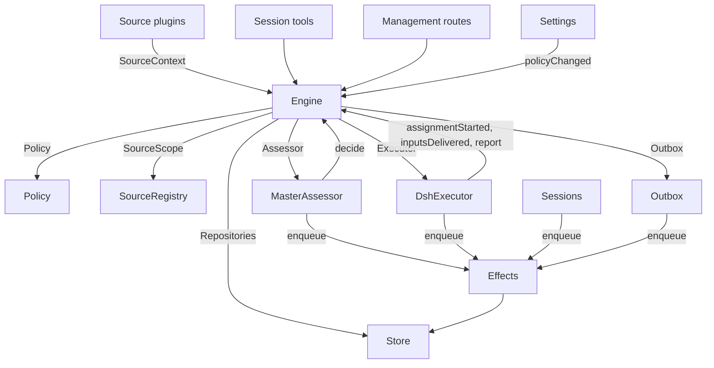

# 007 架构

> 本文为中文译本，内容以英文原文为准：[原文](007-architecture.md)。

本文是实现的开发者指南。它把 [001 领域模型](001-domain.zh-CN.md) 到 [006 部署](006-deployment.zh-CN.md) 中的概念映射到类、接口与文件。先读 Runtime 与 Engine，再把模块表与测试表当作代码索引。

## 核心类与胶合层（Glue）

核心类在小接口之后持有领域概念与外部边界。胶合层把工具参数、HTTP 请求、来源（Source）载荷与 DeepSeek Harness 事件转换为对这些类的调用，再把结果转换为卡片、视图与消息。

`Runtime`（`src/app/runtime.ts`）构造应用、供给依赖，并负责启动与关闭。`Engine` 构造自己的内部部件。执行器（Executor）与研判器（Assessor）会回调 Engine，因此 Runtime 向它们提供取值器，而不要求按循环顺序构造。

### Runtime

`Runtime` 是组合根；它不含任何领域规则。其构造函数锁定状态目录、打开 Store 并构建每个组件。若构建失败，它关闭 Store 并释放锁。

启动时注册管理路由并运行 Setup。setup 解析完成后，它安装 Session 与执行器钩子、确保主 Session 存在、启动策略（Policy）同步、恢复被中断的派工，并启动轮次与副作用。`ready` 标记启动完成。

关闭时取消回合、等待轮次、副作用与智能体结束，恢复进程环境、关闭 Store 并释放锁。来源插件通过窄接口 `SourceHost` 把 Runtime 注入为 `orchestrator` 服务。

| 部件 | 模块 | 职责 |
| --- | --- | --- |
| Setup | `src/app/setup.ts` | 解析仓库与账户——通过探测它们的 CLI，与 worker（执行器 Session）shell 运行它们的方式一致——写入并应用 worker 的环境与命令 shim，并保留 setup 问题；Settings 通过它检查变更后的账户，并通过它重启，而重启会再次运行 setup |
| Passes | `src/app/passes.ts` | 同一时间只跑一个轮次，每两秒以及任何命令要求时运行：先处理到期的副作用，再执行 `Engine.evaluateDue`；来源的触发（Trigger）通过它抵达 Engine |
| Outbox | `src/app/outbox.ts` | Engine 的 `Outbox` 端口，也是回执的唯一写入者：`send` 在一个事务中保留消息的回执并排队其 `reply` 副作用，该副作用的处理器通过 `SourceRegistry.send` 发送它；来源关闭时消息等待，会话不存在或未被监听时消息被丢弃 |
| Notices | `src/app/notices.ts` | 把领域事件与 worker 活动转换为主 Session（Main Session）消息。`eventNotice` 处理领域通知；`reportRelay` 立即转发问题，把普通进展留在其工单上，并转发其他报告；`followupRelay` 指出拥有人工跟进的工单。回合进行中到达的转发会在下一步通过 DeepSeek Harness 收件箱一并投递 |

### Engine

`Engine`（`src/core/engine.ts`）是触发、线程（Thread）、决定（Decision）、工单（Ticket）与派工（Assignment）的唯一写入者。它从 `src/core/ports.ts` 接收这些端口：`Repositories`、当前策略取值器、`SourceScope`、`Assessor`、`Executor` 与 `Outbox`。可选依赖为 `prepareTicket`、`now` 与 `emit`。

所有 Engine 方法都是同步的。每个命令在一个事务中改变其聚合。`evaluateDue` 为它改变的每个评估（Eval）或工单使用单独事务。端口在事务内排队外部工作；适配器在提交后执行。非法请求抛出 `UserError`。

Engine 暴露一个入口并委托给五个内部部件。它拥有每个命令的事务。跨部件的命令，如 `attach`、`evaluateDue` 与 `policyChanged`，按顺序调用各部件。

每个部件都扩展 `EnginePart`（`src/core/part.ts`），后者提供选项与共享读取。部件之间的依赖单向流动：

| 部件 | 职责 | 依赖 |
| --- | --- | --- |
| `Intake` | 来源的触发：与其去向（Disposition）一起只存一次，记录在其线程及其关联（Correlation）上，扇出（Fan-out）到订阅（Subscription）的工单；除非它是抵达某个工单的人的消息，否则在其主线程上排队等待评估 | Tickets |
| `Evals` | 线程的评估：批处理，准入（Gate）的强度（Strength）、行动者与依据以及给予它们的触发（`primary`），来自候选交付的截止时间及其因暂停的顺延，过期评估的重新排队，候选、重放与交回，策略变更时的重新排队，以及每个评估最终得出的决定：accept、stop、ignore 或 unavailable | Tickets |
| `Tickets` | 工单生命周期：从 accept 创建并带其授权（Mandate）、订阅与首个派工，它跟随的线程及其关闭（`followsDone`），附加的线程与为上下文而跟随的线程，输入（Input）与备注，恢复以及恢复所拒绝的消息，重试、重启、停止与结束，它丢弃的订阅，以及策略变更通知到受影响的工单 | Replies |
| `Assignments` | 执行器及其 worker 报告的内容：派工已开始、输入是否抵达、重启是否中断、以及 worker 的报告（Report）及其向人提出的问题 | Tickets, Replies |
| `Replies` | 通过 `Outbox` 的渠道（Channel）写入：确认、回答、结果与待人工决定（Attention）消息，各自按其允许的规则（Rule） | 无 |

命令使用祈使式名称，如 `stopTicket`；适配器报告的事实使用过去式名称，如 `assignmentStarted`。查询 `candidate` 使用名词。

调用方只获得其角色对应的 Engine `Pick`：`EngineForSources`、`EngineForMainSession`、`EngineForPeople`、`EngineForSettings` 或 `EngineForExecutor`。

| 角色 | 方法 | 效果 |
| --- | --- | --- |
| Sources | `receive(trigger)` | 只存一次触发并返回 `stored`、`duplicate`，或在没有来源接收时返回 `filtered`；把触发扇出到订阅其线程的工单——若其中是人的消息，且处理未暂停，则立即恢复已结束的工单——并在其主线程上排队等待评估；除非它是抵达某个工单的人的消息，那种情况归该工单所有 |
| Sources | `bindThread(ticketId, thread, own)` | 让一个打开工单跟随来源的某个线程，例如拉取请求的线程，`own` 表示该工单打开了它；已关闭的线程再次绑定时重新打开。结束工单的是线程的关闭，而不是 `ready` 报告 |
| Sources | `threadClosed(thread, outcome, at)` | 某个线程关闭：跟随它的每个打开工单记录该关闭，并在它与所跟随的线程处理完毕（`followsDone`）后结束：它打开的线程都不再打开，或它未打开任何线程时，它跟随的每个线程都已关闭。它以这些关闭中最新的那次相同的方式结束为 `merged` 或 `closed`，除非关闭后恢复的工作尚未报告 `ready`，或其执行器通过确认或回答接手了它在最新一次非 `progress` 的报告之后判定的人的消息跟进，或它最后一个回合的结束；随后一次 `dropped` 报告会像该关闭一样结束它 |
| Main Session | `candidate(triggerId)` | 持有某个触发的评估，按其研判器所见 |
| Main Session | `candidateDelivered(evalId)` | 该评估的候选已抵达主 Session：其截止时间从此开始计算 |
| Main Session | `decide(triggerId, outcome)` | 记录一次评估决定，或为显式请求记录一次直接决定。Accept 以原子方式创建工单、授权、派工、订阅与确认。从卡片忽略的推断候选会在给定原因之前记录 `ignoredFromCard`。当 `followupOwners` 仍拥有人工跟进时，只允许 stop |
| Main Session | `attach(ticketId, triggerId, note?)` | 把触发路由到它指向的工单，该工单的执行器随后将其作为跟进判定，并结束持有它的评估，该评估的其他触发等待一次新的评估；已结束的工单在其授权下立即恢复，除非处理被暂停。执行器仍在判定的跟进会被拒绝；被路由回交回它的工单的跟进也会被拒绝 |
| Main Session | `requestStatus(ticketId)` | 向等待中的执行器 Session 询问状态，并返回它是否询问了 |
| Main Session | `note(ticketId, text)` | 把来自其他工作的事实作为文本输入给予工单的执行器，该输入不授予任何权限 |
| Main Session, Executor | `reply(request)` | 为消息所含目的命名的渠道排队消息：`acknowledgement`、`answer`、`result` 或 `attention` |
| People | `stopTicket(ticketId, reason?)` | 人的停止，会撤回授权 |
| People | `retryTicket(ticketId)` | 结束一个工单的停滞派工——该工单在 `failed` 或 `blocked` 报告后等人，或其输入交付失败（`canRetry`）——并开始新的派工 |
| People | `reevaluate(triggerId)` | 把已存储的触发排队等待一次新的评估 |
| People | `unsubscribe(thread)` | 丢弃某线程上的所有订阅，曾跟随它的工单不再跟随；每个工单仍继续判定它在那里收到的跟进 |
| People | `dismiss(decisionId)` | 关闭 `unavailable` 决定所展示的问题，该决定记录了此问题 |
| Executor | `assignmentStarted(ticketId, assignmentId)` | 派工运行；其等待的输入发出 |
| Executor | `inputsDelivered(ticketId, assignmentId, inputIds)` | 输入抵达派工的执行器 Session（Executor Session），每个输入在那里等待某个回合接手它 |
| Executor | `inputsRead(ticketId, inputIds)` | 执行器 Session 把携带这些输入的消息取入其历史（一条 `user/message` Session 事件），其模型由此获得这些输入；此前已认领且被取消或失败的回合不算。每个输入在其后出现一次报告或回合结束时计为已读，重启后亦然，且其工单结束不会释放它；在读记录之前交付的输入，在其交付之后出现一次报告或回合结束时计为已读 |
| Executor | `turnEnded(ticketId, assignmentId)` | 执行器 Session 的一个回合结束，在报告之后亦然，当其不再有任何后台运行或已交由人处理时。某个回合此前接手的内容，即为其已读（`inputsRead`） |
| Executor | `deliveryFailed(ticketId, assignmentId, error)` | 输入交付失败；工单会展示该失败，直到交付成功、新派工开始或工单结束 |
| Executor | `report(ticketId, report)` | 记录一次报告及其向人提出的问题；`dropped` 结束工单，`ready` 完成一个不跟随任何线程的工单，并按线程结束的方式结束一个已与其所跟随线程处理完毕的工单 |
| Executor | `markUnrelated(ticketId, thread, reason)` | 只丢弃该工单对某个附加线程的订阅——该工单认为它与自身无关——并把该工单在那里判定的跟进连同原因交回 |
| Executor | `followForContext(ticketId, thread)` | 让打开工单为上下文订阅一个相关线程：其消息抵达工单，但不赋予跟进强度，也不会恢复它 |
| Executor | `handback(ticketId, triggerId, reason)` | 记录工单交回一个抵达它的触发，并带上其候选所载的原因；若没有其他工单判定它，则排队等待一次新的评估（若该工单曾判定它）。它返回是否已排队。工单只对每个触发交回一次，并保留其订阅 |
| Executor | `assignmentInterrupted(ticketId, assignmentId)` | 主机停止时某个派工仍在运行：一个在工作中被中断的派工，或一个在其最新报告后收到输入的派工，会带着恢复说明以及交付给它但执行器 Session 未接手的输入重新开始，如同一次重试；一个自那以后已经报告过的派工保留其 Session。DshExecutor 在启动时报告每个（`resume`），最旧的工单优先，并再次排队仍等待的启动 |
| Passes | `evaluateDue()` | 除非处理被暂停：为排队触发仍在等待的线程启动评估，每个线程一次，期间排队的触发作为一批；把超过截止时间的评估的触发再次排队，连续两次，第三次记录为 `unavailable`；并恢复暂停期间人的消息抵达的已结束工单，若其授权仍有效。候选尚未抵达主 Session 的评估不会过期。处理暂停期间没有评估过期，一旦恢复，每个截止时间都顺延暂停的时长 |
| Settings | `policyChanged(from, to, effects)` | 告知每个受变更影响的在线工单其影响方式（`src/policy.ts` 中的 `policyEffects`：它据以接受的规则已变更或不再适用，其请求者可能无法再启动工作，或主动（proactive）工作不再被接受），并在新版本下重启进行中的评估 |

Engine 把批处理、授权、扇出、恢复与待人工决定生命周期规则保持为私有。若干共享谓词使这些规则保持一致：

- `waitsForPerson`（`src/core/model.ts`）：最新派工报告了 `blocked` 或 `failed`，且此后没有人的消息到达。为真时，自动输入与失败的启动保持挂起。
- `followupOwners`：仍对自己线程上收到的人工跟进负责的工单。工单可以是仍在线的，或未经人工停止而结束、等待恢复的。交回该消息即结束该所有权。
- `settled`：某个决定已解决请求；stop、unavailable、routed 与 refused-stop 决定不算。
- `ticketStage`（`src/core/stage.ts`）：实现 [003 执行](003-execution.zh-CN.md) 中的阶段表。

工单结束时，未读的跟进会回到评估，除非另一个工单仍拥有它们，或另一个去向已解决它们。已确认、已回答与已交回的消息被排除。对于没有确认去向的旧记录，outbox 回执提供该事实。最终报告也涵盖派工开始时仍在等待的消息，包括恢复它的那条消息。停止工单的那条消息不会被自动重新评估。

变更之后，Engine 从 `src/core/ports.ts` 中的 `DomainEvents` 发出一个事件：

`trigger.received`、`eval.started`、`decision.recorded`、`ticket.created`、`ticket.resumed`、`ticket.ended`、`assignment.started`、`assignment.ended`、`thread.subscribed`、`thread.unsubscribed`、`trigger.requeued` 或 `policy.changed`。

Runtime 把 `ticket.ended`、`trigger.requeued` 与 `thread.unsubscribed` 转换为通知。交付到工单的人的 `trigger.received` 会成为跟进转发。`pullEndNotices` 在工单以 merged 或 closed 结束时，使用稳定 id 发送一条聊天通知。Runtime 还为观测页记录领域事实，包括输入创建、送达和读取、PR 绑定和 Worker 报告。

本机管理 API 提供 `GET /orchestrator/api/observatory` 读取状态及游标，提供 `GET /orchestrator/api/observations` 读取 SSE 事件。事件流从上次收到的事件 ID 或指定游标继续。领域事件与状态变更共同提交，提交后可从事件流读取。

### Model

`src/core/model.ts` 存放领域类型，`src/core/stage.ts` 存放工单阶段。决定以 `reason` 记录原因，即一组 `Reason`（`src/core/reasons.ts`）：每个都有其 `code`、`values`，以及一批触发中某个触发的 `triggerId`。

核心的代码，如 `timeout`、`policyChanged`、`routed` 与 `startedTicket`，属于 `REASONS`，带有智能体（Agent）通过 `reasonText` 读取的英文；准入或来源范围（Scope）提供自己的代码，如 `not_a_member`；`said` 载有研判器或人写下的文字。面板（panel）用 `reason.<code>` 为每个代码配词，来源过滤掉的触发也以同样方式记录来源的代码。

工单只保留每个事实一次。它没有 `ended` 时即为打开状态，`ended` 记录何时、由谁、为何以及以何结果结束；它最后所述为其最新派工报告（`latestReport`）；其执行器 Session 以其命名（`src/executor/dsh.ts` 中的 `workerSessionId`）。

其字段是有类型的：`origin`，给予其评估批次强度的可准入触发以及该批次本身（`triggerId`、`triggerIds`）；`execution`，执行器所选（`name`、`directory` 与 `assignment`）；`delivery`，最后一次失败的输入交付（`error`、`at`），直到交付成功、新派工开始或工单结束；`follows`，来源让它跟随的线程，每个为 `{thread, own, closed?}`：工单打开它时 `own`，关闭后 `closed` 附带 `at` 与 `outcome`。只有工单写入 `follows`；GitHub 来源用 `pullsOf` 与 `pullOf` 读取其拉取请求（`src/sources/github-pull.ts`）。

携带触发的输入记录它是否由人书写，`waitsForPerson` 读取此信息。线程还在 `context` 中列出仅为上下文而跟随它的订阅工单，并在 `expired` 中统计其排队触发连续过期的次数；评估记录其 `primary` 触发及其候选被 `delivered` 的时间。

触发的去向记录它抵达的工单（通过扇出或附加）、人的重新排队、每个将它交回的工单及其原因，以及每个其执行器确认或回答它的工单。

授权的 `basis`（`MandateBasis`）记录准入如何接纳其触发。重新校验读取接收的 `source`、`scope` 与 `row`，列出的 `sender`、匹配的 `rules` 以及 `via`：

| `via` | 准入依据 |
| --- | --- |
| `addressed` | 允许的发送者向智能体发话 |
| `followup` | 消息抵达带有工单的线程 |
| `admission` | 准入表单元格；`observation` 标记一个推断候选 |
| `bot` | 列表中的机器人产生了一个推断候选 |

触发与线程的 `meta` 归来源所有。核心不解释它们。

### Policy

`src/policy.ts` 定义设置模式、授权与研判（Assessment）规则。`settingsPolicy(settings, scope)` 在每次使用时返回一个新的无状态 `Policy`：

- `version`、`paused` 与 `evalTimeoutMs` 描述其当前状态。
- `gate(trigger, thread, tickets)` 返回准入强度与依据。
- `revalidate(mandate)` 检查现有授权是否仍然有效。
- `admitsInferred(rules)` 仅在自动模式且存在启用的匹配规则时允许主动接受。

`assessmentOutcome(assessment, settings, strength)` 把模型的研判转换为 Engine 结果。它要求对每条启用的规则给出判断、明确的方向、匹配的规则与意图证据。在自动模式之外，推断的 accept 会变成一条“would accept”记录。

`policyEffects(tickets, old, now, scope)` 确定一次变更影响哪些打开工单以及如何影响。`Engine.policyChanged` 只通知这些工单。`policyVersion` 对规则、接单模式（accept mode）以及来源的策略部分（包括机器人列表）做哈希。

### Store

`Store`（`src/app/store.ts`）拥有一个 SQLite 数据库。Runtime 在打开它之前获取目录锁，防止第二个进程迁移或写入同一状态。

其接口按用途分组：

- **领域仓库：** `atomic`，以及 `triggers`、`threads`、`tickets` 与 `decisions`，每个都有 `get`、`save` 和列表查询。带索引的工作集为 `threads.active()`、`tickets.open()`、`tickets.active()` 与 `read.subscribedThreads`。
- **读查询：** `read` 通过 `threadTriggers`、`triggerStats`、`search` 与 `droppedReplies` 等方法服务视图、工具与来源轮询。这些方法从不写入。
- **来源元数据：** `threads.describe` 与 `threads.patchMeta` 更新来源拥有的线程元数据。
- **设置：** `settings`、`saveSettings`、`blockRevision` 与 `settingsHistory`。设置与提示词使用编号的 `Versions`（`src/app/versions.ts`）。
- **Outbox 回执：** `replyStatus` 与 `receipts`，只由 Outbox 写入。回执操作有 `get`、`waiting`、`behind`、`add`、`settle` 与 `withdraw`。`behind` 检查同一工单与同一会话的较早消息是否仍在等待且失败少于三次。撤回的消息以 `channelGone` 或 `channelIgnored` 结算。读查询通过 `failingReplies`、`droppedReplies` 与 `droppedSince` 暴露失败与丢弃的回复。
- **有类型的键值记录：** `get`、`set`、`delete` 与 `keys`，使用 `KV` 中的条目。

`afterCommit` 只在事务提交后运行操作，绝不在回滚后运行。Runtime 按存储形态读取记录；schema 11 迁移在启动时转换较旧的受支持记录。

### Effects

`Effects`（`src/app/effects.ts`）是持久化的副作用队列。命令在其事务内调用 `enqueue(kind, key, payload)`；执行只在提交后开始。

每个 kind/key 对占一行。入队同一等待中的 key 会替换其载荷并使其立即到期，且不改变队列顺序。`handle(kind, run, options)` 为每个 kind 注册一个处理器。它按从旧到新的顺序处理到期行，直至并发上限。

失败按指数退避重试。抛出 `Later` 会推迟工作而不计为失败，例如没有可用的 worker 槽位时。`start` 在 setup 后开始处理，`drain` 在关闭时停止处理并保留待处理行，`pending`/`idle` 暴露队列状态。

| Kind | 处理器 | 职责 | 并发 | 重试 |
| --- | --- | --- | --- | --- |
| `assessment` | MasterAssessor | 把评估的候选卡片引导进主 Session 的回合，然后告知 Engine 它已交付，这会启动评估的截止时间 | 4，暂停时为 0 | 2 秒加倍至 60 秒 |
| `launch` | DshExecutor | 启动一个待处理派工：准备命令、执行器 Session、派工消息 | 空闲 worker 槽位，暂停时为 0 | 模型提供方或网络的暂时性失败在 5 秒后重试并加倍至 300 秒，共三次；任何其他失败以及准备命令失败会使工单失败。被暂停或 worker 槽位已满而挂起的，5 秒后重试 |
| `delivery` | DshExecutor | 按顺序把工单等待的输入交给其正在运行的派工 | 4，暂停时为 0 | 2 秒加倍至 60 秒；等待 worker 槽位的在 2 秒后重试 |
| `relay` | Sessions | 把 worker 的报告或问题，或人的跟进，引导进主 Session 的回合 | 1，按队列顺序 | 2 秒加倍至 60 秒 |
| `notice` | Sessions | 向主 Session 注入通知而不唤醒它 | 1，按队列顺序 | 2 秒加倍至 60 秒 |
| `reply` | Outbox | 通过其来源为渠道发送消息，在其工单到该会话尚未失败三次的较早消息之后；撤回消息会取消它 | 1，暂停时为 0 | 5 秒加倍至 300 秒；来源已关闭或排在较早消息之后的，5 秒后重试 |

每个 kind 在其名称下有一个健康条目。它在其副作用连续失败三次后报告错误，`delivery` 除外，其失败显示在其工单上。转发保持顺序，通知亦然；失败的一条会阻挡其 kind 的后续条目。

### Sources

来源通过 `src/sources/kind.ts` 定义的 `SourceKind` 扩展宿主。一个 kind 声明其身份、标题、描述、配置 `schema` 与 `fields`、派生 `facts` 以及 `health` 条目。可选行为包括 `scope`、`channel`（`allowed`、`send`、`link`）、`threadContext`、`find`、`policy`、`environment` 与 `refreshLabels`。

`SourceRegistry`（`registry.ts`）拥有已注册的 kind 与存储的实例，并实现 Engine 的 `SourceScope`。注册会在 `HealthBoard` 上认领健康条目；重复认领与保留的 `sync:` 名称会被拒绝。SourceContext 只通过其注册所认领的条目写入，因此注销后的报告不起作用。

注册表的配置方法包括 `kind`、`instances`、`instance`、`validate`、`validatePolicy`、`policyPart`、`channelAllowed`、`declarations`、`environments`、`find` 与 `scope`。`find` 询问每个支持搜索的 kind。

通用代码通过注册表访问来源行为。`send(message, commands)` 调用 kind 的渠道，并返回 `sent`、`gone`，或在该 kind 未安装时返回 `waiting`。`link` 解析其渠道链接。`threadContext` 把 kind 的读取器与其配置配对，或在 kind 没有读取器时返回空。无效的存储配置会禁用该实例。

插件接收 `SourceHost`：注册表与 `context(kind)`。kind 自身使用更窄的 `SourceContext`，由 `src/app/source-context.ts` 中的 `sourceContextOf` 构建。

该上下文提供部署与命令、setup 就绪状态（`ready`、`configured`、`problem`）、配置、`receive`、`atomic` 与带类型的 `state`。它还暴露线程读取与元数据写入、工单读取与绑定/关闭命令、触发读取、通过 Outbox 的 `notify`，以及用于声明的健康条目的 `report`。

### DshExecutor

`DshExecutor`（`src/executor/dsh.ts`）为每个工单提供一个 Session 与一个目录。`start` 与 `deliver` 入队 `launch` 与 `delivery` 副作用。`stop` 通过 `Store.afterCommit` 取消回合，因此回滚的结束不会停止 worker。

`prepare(ticket, outcome)` 提供 Engine 的 `prepareTicket` 钩子：短名称、目录与 `ticketExecution` 派工文本。`workerSessionId(ticket.id)` 派生 Session id。

`WorkerSlots` 在启动或唤醒空闲 worker 的交付之前预留容量。人的消息可使用超出 `maxWorkers` 的一个槽位，唤醒优先于启动。`activeCount` 提供面板负载。

暂时性的提供方与网络失败获得三次重试。启动使用副作用退避；失败的回合在 15、30 与 60 秒后收到继续消息。`inputMessage` 从当前工单状态渲染每个输入，`mandateInstructions` 为推断工作添加匹配规则限制。

`install` 订阅 Session 事件；`dispose` 取消订阅。回合结束通常报告等待，就绪之后或需要人工操作时除外。错误报告为 failed。启动时，`resume` 通过 `assignmentInterrupted` 报告被中断的派工，并重新排队不等待人的待处理启动，最旧的工单优先。

### MasterAssessor

`MasterAssessor`（`src/app/assessment.ts`）让主 Session 研判主动候选。`request` 入队一个研判副作用；`release` 在其评估结束时丢弃缓存状态。

它的 `context`、`read` 与 `decide` 方法服务 `orchestrator_eval`、`orchestrator_eval_read` 与 `orchestrator_eval_decide`。它们通过 `SourceRegistry.threadContext` 提供有界线程上下文、仓库上下文与决定提交。没有上下文读取器的 kind 只提供触发与批次。

`assessmentOutcome` 为 `Engine.decide` 转换模型的回答。评估会根据当前策略再次检查推断的接受。

### Settings

`Settings`（`src/app/settings.ts`）读写带版本的设置块。`current` 与 `view` 读取它们；`save(block, value, revision, origin)` 校验保存；`pause(paused, origin)` 改变单独的 `paused` 设置。

每次保存都声明其来源：`panel`、`tool` 或 `sync`。只有 `panel` 能改变执行环境（Execution environment），或 `SETUP_FIELDS`（`src/deployment.ts`）中列出的字段。

策略版本（Policy version）变更会计算 `policyEffects`，记录通知了哪些工单，并调用 `Engine.policyChanged`。`syncable` 与 `sync(id)` 刷新来源的策略部分。`refreshLabels(id)` 刷新显示名称。

### Prompts

`Prompts`（`src/app/prompts.ts`）把配置存为 `Versions`。`current`、`version` 与 `history` 读取它们；`validate`、`preview` 与 `save(value, baseRevision, source)` 校验并保存它们。`compose` 与 `skills` 构建 Session 文本。

`builtInParts` 列出覆盖键、角色、默认文本与必需的模板占位符。每个覆盖存储团队 `text` 与一个 `base`：其原始默认的 `builtInBase` 键。保存会把该默认保留在 `KV.prompts.builtIn` 下。随后 `defaultChanged` 报告已变更的默认、可用时其旧文本，以及被移除的部件。

校验会从已保存的覆盖继承省略的 base，丢弃已存在于已保存数据中的被移除部件，并拒绝空白文本或其他未知键。这允许保存工具对其读取的配置做往返。`environmentSection` 与 `policySection` 只使用自身键替换一次模板值。没有覆盖的配置使用默认。

### Sessions

`Sessions`（`src/app/sessions.ts`）为两个角色管理 DeepSeek Harness Session。`ensure` 用其角色的模型创建 Session。`install` 跟随智能体事件并为受管 Session 注册提示词、技能（Skill）与工具。

`prompt` 每个请求 id 只投递一次。`relay` 与 `notify` 入队由 `relay` 与 `notice` 副作用处理的主 Session 消息。`src/app/notices.ts` 定义其内容；`delivery` 检查消息是否抵达。

每个模型请求都把 Session 绑定到当前提示词修订。它使用的修订会被持久存储：`promptVersion` 标识活动修订，`mayRead` 限制 worker 可查看的修订。注册按智能体分别记在一个映射中。

`status` 与 `promptVersion` 服务提示词页面。保存经过 `Prompts.save` 并通知主 Session。`modelRetry` 暴露模型预算重试状态。

### Glue

| 胶合层 | 转换内容 |
| --- | --- |
| `src/app/runtime.ts` | 组合根：用各部分所用的接口构建它们，注册路由与来源宿主，并启动与停止 dsh-superagent |
| `src/app/notices.ts` | 领域事件与 worker 报告转换为主 Session 的通知与转发 |
| `src/app/tools/main.ts`、`src/app/tools/executor.ts` | 主 Session 与执行器 Session 的工具参数转换为核心类的调用，其结果转换为卡片 |
| `src/app/http.ts`、`src/app/views/`、`src/app/api.ts` | HTTP 请求转换为调用，Store 读取转换为面板视图；`api.ts` 为面板标注每个路由的类型 |
| `src/app/resources.ts`、`src/app/links.ts`、`src/app/cards.ts` | 资源名称转换为读取，来源消息转换为链接，记录转换为供模型使用的紧凑卡片 |
| `src/sources/github*.ts`、`src/sources/feishu*.ts`、`src/sources/poll.ts` | GitHub 与飞书载荷转换为触发与线程事实，消息转换为 CLI 调用 |
| `src/deployment.ts`、`src/setup.ts`、`src/infra/` | Setup 探测与问题、CLI 传输、智能体的进程环境 |

## 依赖规则

- **显式、窄接口的依赖。** 每个类接收一个命名其所用内容的接口，大多为其他类的 `Pick` 类型：核心类的 `ExecutorHost`、`AssessorHost`、`SessionsHost`、`SettingsHost`、`SetupHost`、`PassesHost` 与 `OutboxHost`，胶合层的 `HttpHost`、`MainToolsHost`、`ExecutorToolsHost`、`ResourceHost`、`LinkHost` 与 `SourceContextDeps`，以及作为调用它的角色 `Pick` 的 Engine。Runtime 只在这种接口之后传递自身。来源插件（Source plugin）注入 `orchestrator`（主 Session）服务，其类型将其命名为 `SourceHost`：注册表与 `context(kind)`；其 kind 的代码只能看到自己的 `SourceContext`。
- **谁可以导入谁。** `src/core` 除 Node 的哈希外不导入自身以外的任何内容，也不做 I/O。`src/sources` 不从 `src/app` 导入任何内容。面板只从宿主侧导入类型，以及 `src/admission.ts`、`src/limits.ts`、`src/setup.ts`、`src/navigation.ts`、`src/sources/host.ts`、`src/core/errors.ts`、`src/core/reasons.ts` 的普通值与 `src/app/api.ts` 的过滤列表。
- **每种状态一个写入者。** 每种状态都有一个写入者，其他方读取它或询问该写入者。

  | 状态 | 写入者 |
  | --- | --- |
  | 触发、线程、决定、工单、派工 | Engine |
  | 来源的读取位置，以及它在自己线程上保留的 meta（`label`、`url`、`facts` 及其自身键） | 该来源，通过 `SourceContext` |
  | 设置及其历史 | Settings |
  | 提示词版本 | Prompts |
  | 副作用行 | Effects |
  | Outbox 回执 | Outbox：Engine 的消息与来源的 `notify` 都经过其 `send`，其 `reply` 副作用标记它们 |
  | 健康条目 | 在 `HealthBoard`（`src/infra/health.ts`）上认领它的部件，该板拒绝第二次认领：`runtime` 为 Runtime，轮次通过它报告，`evals` 为 Runtime 在每轮之后，`models` 为 Sessions，每个副作用 kind 为 Effects，`worker` 为 DshExecutor，某个来源 kind 的条目为该 kind 的来源的 SourceRegistry，`sync:<id>` 为 Settings |

  来源只通过 `SourceContext.tickets.bindThread` 与 `threadClosed` 改变工单，这两个方法调用 Engine。
- **请求与事实。** 请求某事的方法以祈使式动词及其宾语命名，如 `stopTicket` 或 `bindThread`，且可能被拒绝；记录适配器所做之事的方法用过去式命名，如 `assignmentStarted` 或 `deliveryFailed`。每个宿主接收其所需角色类型的 Engine。
- **有类型的字段，来源数据归来源所有。** 代码读取工单与授权的有类型字段。来源不在工单上保留任何内容：工单跟随来源的哪些线程为工单的 `follows`，它对触发或线程保留的内容在其 `meta` 中。
- **固定拒绝。** 人或智能体可导致的拒绝为 `src/core/errors.ts` 中 `USER_ERRORS` 的 `UserError(code, values)`。管理 API 对 `missing` 代码返回 404，对其他返回 400，面板用其语言为每个代码配词。Setup 问题为 `SetupError` 代码（`src/setup.ts`），固定的健康文本为 `HealthCode`（`src/sources/host.ts`），同样方式配词。
### 来源相关的依赖

一些通用模块仍直接引用 GitHub 或飞书：

- Outbox 应用飞书的聊天字数限制。
- `src/app/links.ts` 解析飞书消息链接与 `repliedTo`。它与 Runtime 用 `feishuSettings` 读取设置。
- `src/app/resources.ts` 读取 `feishu/` 与 `github/` 原始记录；`src/app/cards.ts` 为工单卡片使用 `pullOf`。
- Runtime 为 merged 或 closed 的工单发送 `pullEndNotices`。
- 执行器工具用 `readPull` 与 `claimPull` 绑定报告的拉取请求，使用 Runtime 暴露的 GitHub 上下文。
- MasterAssessor 用 `readRepositoryPath` 读取仓库文件。
- Sessions 与 Prompts 只为 GitHub 与飞书注册内置技能。迁移转换其 schema-10 记录。
- Setup 只探测 GitHub 与飞书账户字段（`SETUP_FIELDS`）。只有这些来源通过 `SourceContext.problem` 收到账户 setup 问题。

## 模块

| 路径 | 职责 |
| --- | --- |
| `src/index.ts` | 主插件入口：读取机器设置，启动 Runtime，并提供保存来源账户所用的重启 |
| `src/deployment.ts` | 插件 `Config` 与 `Machine`；`resolveDeployment` 与 `resolveFeishuBot` 从来源设置读取仓库与账户，每次 CLI 运行都按执行器 shell 运行它们的方式；`SETUP_FIELDS` 列出 setup 读取的来源字段。代码不命名任何个人、账户或组织 |
| `src/setup.ts` | Setup 问题：`SetupError`，带代码、修复它的位置以及日志、主 Session 与面板共享的英文文本 |
| `src/policy.ts` | 策略：按块的设置 schema、策略版本、准入与授权重新校验 |
| `src/admission.ts` | 准入表的值、每个单元格的选项与默认，与面板共享 |
| `src/limits.ts` | 人可设置值的限制，设置 schema 会检查，面板字段会提供 |
| `src/kv.ts` | `KV`：`kv` 记录的每个族及其键、值类型与所有者，以及 Store 与 `SourceContext.state` 接收的 `Key` 与 `Family` 类型 |
| `src/navigation.ts` | 在主机的目录列出它后，从面板打开一个 DeepSeek Harness Session |
| `src/core/model.ts` | 领域类型，其中包括有类型的工单与 `MandateBasis`，以及 `threadKey`、`ticketOutcome`、`reached`、`followupOwners`、`settled`、`waitsForPerson`、`liveTicket`、`runningAssignment`、`latestAssignment` 与 `latestReport` |
| `src/core/ports.ts` | 端口：`Repositories`、`Policy`、`SourceScope`、`Assessor`、`Executor`、`Outbox`，以及领域事件 |
| `src/core/engine.ts` | Engine，核心的入口，以及角色接口 `EngineForSources`、`EngineForMainSession`、`EngineForPeople`、`EngineForSettings` 与 `EngineForExecutor` |
| `src/core/part.ts` | `EnginePart`，Engine 各部件的基类，以及 `EngineOptions` |
| `src/core/intake.ts` | `Intake`：来自来源的触发，到其工单，并在人的消息抵达某个工单之外时进入评估 |
| `src/core/evals.ts` | `Evals`：线程的评估及其决定 |
| `src/core/tickets.ts` | `Tickets`：工单生命周期、工单跟随的线程、订阅与输入 |
| `src/core/assignments.ts` | `Assignments`：执行器的事实与其 worker 的报告 |
| `src/core/replies.ts` | `Replies`：Engine 的渠道写入 |
| `src/core/stage.ts` | `ticketStage` 与 `canRetry`：[003 执行](003-execution.zh-CN.md) 的工单阶段 |
| `src/core/errors.ts` | `UserError` 与 `USER_ERRORS` |
| `src/core/reasons.ts` | `Reason`、`REASONS` 与 `reasonText`：核心记录决定或搁置触发的按代码原因 |
| `src/core/ids.ts` | `key`：由输入派生的 id，相同输入得到相同值 |
| `src/core/memory.ts` | `MemoryRepositories`：Store 仓库的内存版，按 Store 的顺序并带其嵌套回滚，用于领域测试 |
| `src/core/index.ts` | 核心的导出 |
| `src/app/runtime.ts` | Runtime，组合根及其启动与停止 |
| `src/app/setup.ts` | Setup，以及 `setupChanged`，即一次保存是否改变 setup 读取的字段 |
| `src/app/passes.ts` | Passes，轮次调度器 |
| `src/app/outbox.ts` | Outbox：Engine 的 `Outbox` 端口、回执与发送它们的 `reply` 副作用 |
| `src/app/notices.ts` | 主 Session 的通知与转发：`eventNotice`、`reportRelay`、`resultRelay` 与 `followupRelay` |
| `src/app/store.ts` | Store，以及 `Receipt`，即 outbox 的一条消息 |
| `src/app/store-read.ts` | `storeReads`：用于视图、工具与来源轮询的 Store 读查询，从不写入 |
| `src/app/migration.ts` | schema 11 迁移：从 schema 10 的一步，把每条存储记录写为其当前形态 |
| `src/app/effects.ts` | Effects |
| `src/app/versions.ts` | `Versions`：以编号快照保存记录并带指向当前的指针，用于设置与提示词 |
| `src/app/cache.ts` | `TextCache`：在内存中按大小保留的文本，最先丢弃最近最少使用的 |
| `src/app/settings.ts` | Settings |
| `src/app/settings-history.ts` | `policyHistory`：每个已保存设置修订及其相对前一修订的变更 |
| `src/app/prompts.ts` | Prompts、`builtInParts`（团队可覆盖的内置部件）与 `promptParts`（角色提示词各节的顺序） |
| `src/app/context.ts` | 内置提示词文本，从 `prompts/` 读取，以及 Session 读取的记录条目 |
| `src/app/skill-files.ts` | 打包的文本：`promptFile`，把文件中一句一行的行合并为段落，以及捆绑的技能 |
| `src/app/sessions.ts` | Sessions |
| `src/app/delivery.ts` | `AgentDelivery`：把消息每个请求 id 只投递一次给 DeepSeek Harness 智能体，恢复的 Session 亦然 |
| `src/app/retry-health.ts` | `RetryHealth`：哪些 Session 在等待模型预算重试，用于 `models` 健康条目 |
| `src/app/role-models.ts` | 解析评估与执行器模型，并用其角色的模型初始化新 Session |
| `src/app/assessment.ts` | MasterAssessor、研判 schema 以及 `orchestrator_eval` 回答的窗口 |
| `src/app/execution-environment.ts` | 执行环境：其变量、工单的值、目录根与提示词节的行，由 `src/app/prompts.ts` 填入其模板 |
| `src/app/source-context.ts` | `sourceContextOf`：每个来源 kind 的 `SourceContext` |
| `src/app/links.ts` | `sourceLink`、触发消息的页面，以及 `candidateCard` |
| `src/app/cards.ts` | 供模型使用的触发、工单、线程与决定的紧凑卡片，工单卡片状态的封闭集合 `TICKET_STATES`，以及 `textPage` |
| `src/app/resources.ts` | `RESOURCES` 与 `readResource`：`orchestrator_read` 为每个角色读取的内容 |
| `src/app/tools/tool.ts` | `Tool` 类型、`readTool`、两个角色的 `orchestrator_read`，以及 `AcknowledgementSchema` |
| `src/app/tools/main.ts` | 主 Session 的工具 |
| `src/app/tools/executor.ts` | 执行器 Session 的工具 |
| `src/app/http.ts` | `/orchestrator/api` 路由：同源检查、请求限制以及每类失败的单一状态 |
| `src/app/api.ts` | `Api`，每个路由及其参数、查询、请求体与响应，以及列表的过滤器；它只导入类型，因此面板会打包它 |
| `src/app/views/text.ts` | 视图文本的两种形式：`preview`，单行纯文本，以及 `markdown`，不含 HTML；`plain` 与 `readable` |
| `src/app/views/records.ts` | 视图共享的行：触发、工单、线程、决定与渠道链接，以及 `ownersOf`，即一次请求所读的跟进所有者 |
| `src/app/views/tickets.ts` | 按阶段的工单列表、工单页面、授权依据事实与执行器负载 |
| `src/app/views/threads.ts` | 线程列表、线程时间线、搜索与决定列表 |
| `src/app/views/sources.ts` | 来源状态：每个来源实例的状态、其最后一天的计数，以及它在当天过滤与丢弃的内容 |
| `src/app/views/settings.ts` | 设置页视图：带修订的每个块、带 kind 表单的每个来源设置，以及执行环境 |
| `src/app/views/overview.ts` | 概览：需要人的工单、问题、最后一天的流转与执行器负载 |
| `src/executor/dsh.ts` | DshExecutor、`WorkerSlots`、`ticketExecution`、`inputMessage` 与 `mandateInstructions` |
| `src/executor/background.ts` | worker 在 DeepSeek Harness 中的后台工作，其 Session 拥有的 shell 作业（`ctx.jobs`）与其子智能体（`ctx.subagents`）：`runningJobs`、`untilQuiet`、`killJobs`、`collectJobs`、`stopSubagents`、`stopBackground`、`until`，以及 `cancelled`，即停止其子智能体取消了回合的 worker |
| `src/infra/commands.ts` | `Commands`，CLI 传输：`run`；`api` 与 `pages`，限于已配置的仓库并经过校验；`lark` 作为机器人；`git`。`CliError` 带命令输出报告的代码，如 GitHub HTTP 状态；不打印任何内容的命令以它如何结束而失败，绝不以它的参数；`validItems` 跳过并统计列表中的畸形项 |
| `src/infra/environment.ts` | 智能体的进程环境：命令 shim、git 配置与凭据助手、`runAsWorker`，以及环境与工单目录的检查 |
| `src/infra/paths.ts` | 包的根，即打包文件所在之处 |
| `src/infra/text.ts` | 字数统计与聊天消息限制、`fill` 与 `sameName` |
| `src/infra/health.ts` | `HealthBoard`，每个部件的健康条目，各由其唯一写入者认领 |
| `src/sources/kind.ts` | `SourceKind` 协议 |
| `src/sources/registry.ts` | `SourceRegistry` |
| `src/sources/host.ts` | `SourceHost`、`SourceContext`、`Health`、`health` 与固定的健康文本 |
| `src/sources/poll.ts` | GitHub 与飞书轮询共享的内容：`POLL_HORIZON_MS`、`polled`、`cursorAt`，以及 `pollThreads`，把失败作为 `pollError` 保留在线程上 |
| `src/sources/github.ts` | GitHub kind 与插件入口，导出为 `./github-watch`：通知轮询轮、打开工单的拉取请求及其 CI，以及订阅的线程 |
| `src/sources/github-trigger.ts` | GitHub 评论、评审、Issue 正文与 CI 变更作为触发，以及 GitHub 地址 |
| `src/sources/github-pull.ts` | 拉取请求规则：工单跟随哪些拉取请求（`claimPull`、`observePull`）、向 Engine 报告的关闭，以及 `pullEndNotices`，即工单以 merged 或 closed 结束时发送的聊天通知 |
| `src/sources/github-channel.ts` | GitHub 渠道：评论与评审线程回复，`sent` 或 `gone` |
| `src/sources/github-read.ts` | CI 快照、仓库读取、`github/` 资源，以及 `githubThreadContext`：按页读取 Issue 或拉取请求的会话 |
| `src/sources/feishu.ts` | 飞书 kind 与插件入口，导出为 `./feishu-watch` |
| `src/sources/feishu-trigger.ts` | 飞书消息作为触发，对实时事件、历史页与话题页使用同一种规则 |
| `src/sources/feishu-loops.ts` | 飞书循环：事件消费者、历史恢复、聊天名称与订阅话题的轮询 |
| `src/sources/feishu-channel.ts` | 飞书渠道：话题回复，`sent` 或 `gone` |
| `src/sources/feishu-read.ts` | 触发消息及其根、父与话题的 `feishu/` 读取，以及 `feishuThreadContext`，把它们连图片交给研判 |
| `src/sources/admission-context.ts` | 研判起点的有界窗口：通过其 kind 读取的触发线程首页，以及触发周围的消息 |
| `src/sources/feishu-image.ts` | 把飞书消息的图片读取为研判 Session 的附件 |
| `src/client/index.tsx` | 客户端插件入口：侧边栏条目、主面板与 DeepSeek Harness 插件管理器中的页面 |
| `src/client/app.tsx` | 面板：头部、搜索、术语表、标签页与当前路由的页面 |
| `src/client/provider.tsx` | 每个页面从其宿主读取的内容：文案、调用、导航、通知、状态轮询，以及 `restart`，它在 dsh-superagent 重启期间快速读取状态 |
| `src/client/api.ts` | 管理 API 的调用与轮询，由 `src/app/api.ts` 标注类型，以及评估状态的决定的过滤器 |
| `src/client/route.ts` | 标签页、设置组、`parseRoute` 读取的有类型路由，以及最后打开设置组的轮由记忆 |
| `src/client/overview.tsx` | 概览 |
| `src/client/source.tsx`、`trigger.tsx`、`eval.tsx`、`execution.tsx` | 每个阶段一个文件：其状态，以及其设置（若有） |
| `src/client/thread.tsx`、`ticket.tsx` | 记录页面：线程及其时间线，以及工单及其授权、输入与派工 |
| `src/client/settings.tsx` | 设置标签页：组导航与屏幕上的组 |
| `src/client/settings-kit.tsx` | 设置块的构建块：阶段组共享的设置、`useBlockDraft`、字段（其中包含来源 kind 的字段）以及保存历史 |
| `src/client/prompts.tsx` | 提示词设置：页面拥有其读取的视图，其编辑器拥有草稿，编辑、完整提示词与历史标签页由它们渲染；内置部件的编辑器展示已更改的默认，并保留或丢弃覆盖 |
| `src/client/prompt-config.ts` | 按节、团队节、技能名、内置部件（`part/<key>`，带 `withOverride`）与提示词视图给出的部件标题的提示词配置，以及完整提示词的行差异，皆为纯函数 |
| `src/client/deployment.tsx` | 部署设置，也在 DeepSeek Harness 的插件管理器中显示 |
| `src/client/draft.tsx` | 设置草稿：`draftReducer`、其状态及其与更新的已保存修订的合并、`saveBarText`（保存栏的一行）以及保存栏 |
| `src/client/controls.tsx` | DeepSeek Harness 控件的本地副本，遵循其标记、键盘行为与设计令牌，因为该 bundle 不导入 `@deepseek-ai/dsh-client-ui-primitives`；它们不读取任何上下文 |
| `src/client/widgets.tsx` | 页面共享的小组件，读取面板上下文：节、页头、加载状态、时间、链接、已确认操作、setup 检查与 Markdown |
| `src/client/rows.tsx` | 页面共享的行：工单、线程与决定、线程的 chip，以及自动化消息连续段的折叠 |
| `src/client/markdown.ts` | 报告与问题的 Markdown 子集，以及消息中的裸地址，作为块与行内部分 |
| `src/client/text.ts` | 按键的文案与领域值、原因、发送者与时间的措辞 |
| `src/client/marks.ts` | 视图分类状态的标记：工单或线程的阶段、来源的状态与决定的结果，各为点、图标、色调与标签 |
| `src/client/locales.ts` | 两种语言的全部文案，以及 [001 领域模型](001-domain.zh-CN.md) 的术语表 |
| `src/client/client.css`、`css.d.ts` | 面板的样式表，以文本加载 |

`src/sources/github.ts` 与 `src/sources/feishu.ts` 也是两个来源插件的入口，由 `tsdown.config.ts` 构建，并在 `package.json` 中导出为 `./github-watch` 与 `./feishu-watch`。bundle 的 `cordis.patch.yml` 插入三个插件，飞书被禁用。

## 测试

| 测试 | 覆盖 |
| --- | --- |
| `tests/core-engine.spec.ts` | 内存仓库上的领域规则：接收、评估、扇出、恢复与停止、被中断的派工、暂停、策略变更、报告与结果、附加、回复、失败的交付与被关闭的问题 |
| `tests/stage.spec.ts` | 逐行的工单阶段 |
| `tests/policy.spec.ts` | 来源范围、准入、准入表、授权重新校验、策略版本、设置迁移与研判结果 |
| `tests/registry.spec.ts` | `SourceRegistry`：实例、校验、策略部分、渠道与线程上下文 |
| `tests/sources.spec.ts` | `SourceContext` 上的飞书与 GitHub 来源：转换、轮询与读取位置、拉取请求规则、健康 |
| `tests/commands.spec.ts` | 以部署的账户执行 CLI 调用、渠道的回答，以及限定仓库的 GitHub 调用 |
| `tests/feishu-read.spec.ts`、`tests/github-read.spec.ts` | 飞书与 GitHub 读取 |
| `tests/admission-context.spec.ts`、`tests/feishu-image.spec.ts` | 研判的线程窗口，以及飞书图片读取 |
| `tests/assessment.spec.ts` | MasterAssessor 每个评估保留的内容，以及何时释放 |
| `tests/background.spec.ts` | 等待 worker 的 shell 作业与子智能体：唤醒它的结束，以及停止的宿主 |
| `tests/bundle-patch.spec.ts` | bundle 的补丁，按 DeepSeek Harness 读取它的方式，以及它定义执行器 Session 的智能体预设 |
| `tests/effects.spec.ts` | 副作用队列：合并、限制、退避重试、健康与关闭 |
| `tests/passes.spec.ts` | 轮次：一次一个，轮次期间请求的在轮次后作为一次运行，以及失败轮次报告的运行时健康 |
| `tests/outbox.spec.ts` | 运行中 Runtime 上的 Outbox：处理暂停或来源未安装时消息等待 |
| `tests/cache.spec.ts` | `TextCache` |
| `tests/queue.spec.ts` | Runtime 通过副作用队列的工作，以及较早版本存储的内容 |
| `tests/followups.spec.ts` | 工单线程上人的跟进：其对主 Session 的通知、作用于它的工具、一次突发的代价；worker 的交回与上下文跟随，以及主 Session 的备注 |
| `tests/health.spec.ts` | 每个部件一个健康条目，各由其自己的下次成功清除 |
| `tests/delivery.spec.ts` | `AgentDelivery` |
| `tests/retry-health.spec.ts`、`tests/role-models.spec.ts` | 模型预算重试，以及两个角色的模型 |
| `tests/runtime.spec.ts` | 模拟 DeepSeek Harness 宿主上的整个应用，经由工具与 HTTP |
| `tests/tools.spec.ts` | Session 的工具：`orchestrator_read` 为每个角色读取的内容，以及其他主 Session 工具的形状与检查 |
| `tests/runtime-concurrency.spec.ts` | 重叠的工作：轮次期间的触发，交付与启动期间变化的工单 |
| `tests/http.spec.ts` | 同源与回环检查、每类失败的状态、请求体限制、路径参数与查询 |
| `tests/settings.spec.ts` | 与模型或账户检查竞争的设置保存、被保存超越的策略同步，以及暂停、同步与块的拒绝 |
| `tests/views.spec.ts` | 管理视图从 Store 派生的内容，如被丢弃消息所属的线程 |
| `tests/timeline.spec.ts` | 线程的页面与按时间再按 id 的触发邻居，每个收到的触发时间以单一形式表示 |
| `tests/migration.spec.ts` | schema 11 迁移：每条存储记录为其当前形态，以及对更旧 schema 的拒绝 |
| `tests/store.spec.ts` | 仓库及其工作集（SQLite 中与内存中）、kv 区域（`KV` 的每个键只在 `src/kv.ts` 与迁移中拼写）、设置历史与查询 |
| `tests/prompts.spec.ts` | 提示词校验、组装与版本 |
| `tests/cards.spec.ts` | 内置文本必须陈述的规则，逐文件 |
| `tests/model-surface.spec.ts` | 模型读取的一切：工具、提示词、技能与输入，对照工具 schema、执行环境与术语表检查，每个角色有大小预算 |
| `tests/deployment.spec.ts`、`tests/environment.spec.ts`、`tests/index.spec.ts` | 插件配置与 setup、智能体的进程环境、插件入口 |
| `tests/service-script.spec.ts` | `scripts/dsh-superagent` 对伪造的 `ps`、`tmux` 与 `dsh` |
| `tests/client.spec.tsx`、`tests/navigation.spec.ts`、`tests/controls.spec.tsx` | 客户端插件的注册与轮询、Session 导航与路由记忆、本地控件，以及面板的导入无循环 |
| `tests/panel-overview.spec.tsx`、`panel-source.spec.tsx`、`panel-trigger.spec.tsx`、`panel-eval.spec.tsx`、`panel-execution.spec.tsx` | 面板的每个页面，对照按路由作答的伪造管理 API |
| `tests/panel-settings.spec.tsx`、`panel-prompts.spec.tsx`、`panel-deployment.spec.tsx`、`panel-panel.spec.tsx` | 设置组、草稿与历史、提示词、部署页面，以及面板的搜索、术语表与路由记忆 |
| `tests/draft.spec.ts`、`tests/prompt-config.spec.ts`、`tests/markdown.spec.ts`、`tests/marks.spec.ts` | 草稿状态、合并与保存栏的一行；按节与行差异的提示词配置；Markdown 子集及其链接；视图分类的每个状态的标记 |
| `tests/locales.spec.ts`、`tests/styles.spec.ts` | 两种语言的文案、样式表 |
| `tests/class-docs.spec.ts` | `src` 中每个类此前都有一个 JSDoc 块 |
| `tests/docs.spec.ts` | 编号文档只链接到更早的文档、每个本地链接可解析、没有文档含合并冲突标记，且本文的表格列出每个模块与每个测试 |

`tests/fixtures/` 存放多个测试共享的内容：`host.ts`，模拟的 DeepSeek Harness 宿主；`panel-server.ts` 与 `panel.tsx`，伪造的管理 API 与页面周围的面板；`deployment.ts`，已解析的部署；`git.ts`，测试启动的每个 git 的环境，且不命名任何仓库；以及 `async.ts`。

## 持久化

一个 SQLite 文件，`<stateDir>/orchestrator.sqlite`，只有 Store 打开它。

| 表 | 存放 | 写入者 |
| --- | --- | --- |
| `trigger` | 每个触发，其时间 `at` 采用 `Date#toISOString` 给出的唯一形式，在 Engine 接收它时设置，因此时间按文本比较 | Engine |
| `disposition` | 每个触发的去向：`filtered` 带来源的原因代码、其评估与决定、它抵达的工单（通过扇出或附加）、是否被重新排队、交回它的工单及其原因，以及其执行器确认或回答它的工单 | Engine |
| `trigger_thread` | 每个触发所在的线程、其时间以及是否由人书写，因此线程的触发无需扫描所有触发即可读取，按时间再按 id 排序：线程时间线的一页从 `<at>\|<id>` 游标继续，共享同一时间的触发不会被跳过 | Store，与每个触发一同写入 |
| `thread` | 线程：订阅、仅为上下文跟随它的工单、排队的触发、进行中的评估、其过期次数与 `meta`；生成列 `active`（在触发排队或评估运行时设置）与 `subscribed`（工单订阅它时为其来源） | Engine；来源写入 `meta` |
| `ticket` | 工单及其授权、来源、执行、派工、渠道、输入与它跟随的线程；生成列 `open`（在未结束时设置）与 `active`（在输入未交付或最新派工待处理或正在运行时设置） | Engine |
| `decision` | 决定，按线程 | Engine |
| `effect` | 副作用队列：每个 kind 与 key 的载荷、其顺序、带最后错误的失败尝试以及到期时间 | Effects；schema 11 迁移为先前版本保留给主 Session 的内容排队 |
| `outbox` | 每条发往渠道的消息的回执，按 id，带其所属工单与其 `status`，即 `pending`、`sent` 或 `dropped`，保留以便 id 不会排队两次；对于被丢弃的消息，何时与为何，作为生成列 `dropped`、其时间与原因代码。等待中的消息有一个 `reply` 副作用，持有其尝试 | Outbox |
| `kv` | 其他每条记录，按键 | 命名它的部件 |

生成列由其行的 JSON 计算，在其集合之外为空，且每个都在其集合上有索引，因此轮次只读取活动工作。早于某列的数据库在 Store 打开它时会补上该列。

`KV`（`src/kv.ts`）定义每个键值记录的所有者、键与类型。所有读写者都使用这些条目；只有迁移代码命名更旧的键。

| 记录 | 键或内容 |
| --- | --- |
| Schema | 当前 schema 版本 |
| 设置版本 | `settings-revision`、`settings-version:<n>`、`settings-block-revision:<block>`；快照包含来源、策略版本与受影响的工单 |
| 提示词版本 | `prompt-revision`、`prompt-version:<n>` |
| 主 Session | `master-id` |
| Session 提示词历史 | `session-prompts:<session id>` |
| 来源状态 | 读取位置如 `github-cursor:<number>`、PR CI 指纹与已见的飞书话题消息；键以 kind 或 `thread-` 加线程键开头 |
| 显示名称 | `source-labels:<source id>` |

关闭记录在其决定上。输入文本在读取时从工单渲染，因此两者都不需要单独的键值记录。

读缓存使用有界的内存 `TextCache` 实例，并在重启时丢失。分页浏览原始来源记录或提示词预览的 Session 必须在重启后从偏移 0 重新读取。接收之后解析的飞书链接以同样方式缓存；基于链接的搜索只有在当前进程生命周期内读取过该链接后才能找到它们。

目前没有删除旧记录，因此以下内容会无限增长：`trigger`、`disposition` 与 `decision` 行；已结束的工单及其线程；outbox 的回执；以及 `kv` 中每个已保存设置修订与提示词版本、每个 Session 在其下工作过的提示词修订，以及来源按线程和按 Issue 或拉取请求保留的记录。

`SCHEMA_VERSION` 只增加。更新版本的数据库拒绝启动；`src/app/migration.ts` 在启动时一次升级预发布 schema 10 的数据库，并拒绝更旧的。

## 面向模型的接口

### 主 Session 工具

主 Session 有 14 个应用工具：

| 用途 | 工具 |
| --- | --- |
| 读取与路由 | `orchestrator_read`、`orchestrator_route` |
| 管理工单 | `orchestrator_ticket_retry`、`orchestrator_ticket_request_status`、`orchestrator_ticket_note` |
| 重新评估 | `orchestrator_trigger_requeue` |
| 研判主动工作 | `orchestrator_eval`、`orchestrator_eval_read`、`orchestrator_eval_decide` |
| 沟通（Communication）与取消订阅 | `orchestrator_reply`、`orchestrator_thread_unsubscribe` |
| 配置 | `orchestrator_settings_save`、`orchestrator_policy_sync`、`orchestrator_prompts_save` |

`orchestrator_route` 按顺序接受 1–20 个决定。每个 accept、attach、stop 或 ignore 都作为单独的 Engine 命令运行。它还允许直接从卡片忽略一个推断候选。`orchestrator_ticket_note` 发送事实作为上下文，而非授权。

设置保存选择 `policy`、`eval`、`executor`、`pause` 或 `source`；最后一项还要指定其来源 id。带 `preview: true` 的提示词保存只组装文本而不保存。

主 Session 还拥有 DeepSeek Harness 的 `skill`、`bash`、`read`、`read_image`、`job_output`、`job_list` 与 `job_kill`。避免代码读取是一项提示词规则，而非工具限制。

### 预设与等待限制

新的主 Session 使用 `dsh-superagent-router`（`ROUTER_PRESET`）。shell 命令与作业等待在 5 秒后返回。若 Web UI 在第一回合之前选择了另一预设，`Sessions` 会恢复此预设，或对 worker 使用 `WORKER_PRESET`。

`src/app/sessions.ts` 中的 `noWait` 守卫拒绝在命令位置调用 `sleep` 的主 Session shell 命令、超过 30 秒的 shell `timeoutMs`，以及超过 5 秒的 `job_output` 等待。报告与作业结果会自动到达，因此等待只会延迟到来的候选。

位于 `standard` 的现有主 Session 也需要为前台命令与作业等待显式设置超时；否则该预设的默认会分别让回合挂起 60 秒与 30 秒。宿主通过 `presetForSession` 确定当前预设，退化到 Session 投影或标头，若无法读取该值则假定为 `standard`。

### 执行器工具

每个执行器有六个应用工具：

| 工具 | 用途 |
| --- | --- |
| `orchestrator_read` | 读取其自身工单可用的资源 |
| `orchestrator_ack` | 确认请求 |
| `orchestrator_report` | 报告进展或结果，按拉取请求规则绑定拉取请求 |
| `orchestrator_thread_unrelated` | 丢弃无关的附加线程，交回其拥有的跟进并告知主 Session 原因 |
| `orchestrator_thread_follow` | 为上下文订阅相关线程并告知主 Session |
| `orchestrator_trigger_handback` | 交回一条消息一次，并带上其候选所载的原因 |

若另一工单仍拥有该消息，或此工单从未拥有它，交回返回 `queued: false`。例如，机器人消息独立地进入评估。

worker 预设定义在 `cordis.patch.yml` 中，并通过 `WORKER_PRESET` 选择。`src/app/sessions.ts` 中的 `WORK_TOOLS` 保留可用的文件、搜索、shell、作业、web、技能、待办与子智能体工具。worker 不会获得向人询问或展示、更改配置、在 worker 槽位之外安排工作、启动或向其他 Session 发消息，或编辑外部文档的工具。工单结束后工具调用被拒绝。

### 结果形状与研判上下文

路由结果使用 `{decision?, reason, ticket?}`。`orchestrator_route` 返回 `{results}`，保持条目顺序，并为每个条目添加 `trigger_id` 与 `kind`。非法或被拒绝的条目返回 `refused` 与一个原因，而不停止整批。

设置与提示词保存返回已保存的配置。策略同步返回来源、允许列表大小，以及 `added` 与 `removed` 名称。

`orchestrator_eval` 返回上下文而非指令。研判指令位于 `runtime/admission`（`prompts/admission.md`），规则位于 `runtime/policy`。其上下文包括：

- 触发文本，最多 4,000 个字符，带图片 id 与批次中的其他触发。
- 最多八个 `related_tickets`，打开的在前，以及 `tickets_total`。
- 该评估的 `policy_version`。
- 线程窗口：前五条消息以及触发两侧各五条。消息使用 `{id, from, at, text}`，通常限制为 400 个字符，两侧各两条则为 1,200。被截断的消息包含 `chars`；图片引用使用 `images`。
- 其他已加载消息作为 50 字符的 `{id, from, preview}` 存根。`orchestrator_eval_read` 按 id 展开它们。

工单卡片使用 `src/app/cards.ts` 的封闭 `TICKET_STATES` 集合：一个打开阶段如 `person/review` 或 `working/queued`，或一个结束结果。确认限制为 100 词，无论通过 accept、研判还是 `orchestrator_ack` 提交。

### 读取资源

`src/app/resources.ts` 中的 `RESOURCES` 定义资源并生成工具的 `resource` 描述。

| 资源 | 内容 |
| --- | --- |
| `tickets`、`triggers`、`threads`、`decisions` | 分页列表，为 `{items, next_offset}`；活动列表最新在前 |
| `decision/<id>` | 一个决定 |
| `thread/<key>` | 标签、工单、最近的决定与一页触发 |
| `trigger/<id>` | 消息文本、被回复的触发与相邻消息，排除 CI 运行 |
| `ticket/<id>` | 相关 id、来源批次触发、线程，以及派工与输入的第一页 |
| Ticket 子资源 | `/assignments`、`/inputs`、`/assignment`、`/result`、`/report/<assignment id>`、`/transcript`、`/message/<n>`、`/input/<id>` |
| `settings`、`settings/<block>` | 修订与摘要，或一个可保存的完整块 |
| `prompts`、`prompts/<revision>`、`prompts/current`、`prompts/defaults`、`prompt-preview/<id>` | 提示词配置与组装后的文本 |
| `models`、`models/<provider>` | 可用模型 |
| `feishu/<trigger id>/…`、`github/…` | 原始来源记录，在来源技能中描述 |

工单线程对仅为上下文的跟随标记为 `context`，对来源绑定标记为 `bound`。派工页最新在前并包含报告预览。用 `next_offset` 继续列表。`/input/<id>` 接受输入的 name 或 id。`settings` 完整包含小块的设置，并概括策略与来源块。

来源资源包括消息邻域、`github/pulls/<n>/thread/<comment id>` 与 `github/commits/<sha>/checks`。

原始记录的消息以一种紧凑形状读取：`{id, from, at, text, reply_to?, path?, line?, url?}`，而不是 GitHub 或飞书记录它们的方式。

执行器 Session 只读取其自身工单、其线程、抵达它或其请求所持有的触发、它在其下工作过的提示词版本以及原始记录，其页面省略它无法读取的内容、决定与其他工单的 id。

页面展示的每个 id 都通过其中之一读取，因此 Session 从一个对象走到下一个；不承载读取依据的哈希，例如评估的 id 或策略版本，均不出现在页面上。

文本页默认 4,000 个 UTF-16 代码单元，最多 8,000；列表默认 20 项，最多 50。

较早版本的名称 `event/`、`task/` 与 `observation/` 仍然可解析。

### 投递给 Session 的消息

这些消息被引导进主 Session 的回合：

| 消息 | 内容 |
| --- | --- |
| Candidate | 批次触发卡片、线程、`related_tickets`、`tickets_total`、`delivered_to`、来自 Issue/PR 链接的引用工单、`handed_back` 原因以及下一步操作 |
| `follow_up` | 一条按执行器所见呈现的消息，`replies_to`、接收工单，以及提醒：执行器判定它，而主 Session 只能停止工作 |
| `worker_report` | 工单卡片、来源触发、状态与最多 600 字符的摘要；被截断时含 `chars` 与读取指针 |
| `worker_attention` | 携带问题的工单卡片 |

其他通知被注入而不唤醒主 Session：`ticket_ended`、`settings_saved`、提示词保存、触发重新排队、丢弃的订阅与上下文跟随。设置通知给出块、变更路径与 `read: settings/<block>`。主 Session 对自己执行的保存、重新排队、取消订阅或附加不收到冗余通知。

worker 以内联方式接收派工与输入。第一条消息包括标题、最多 1,500 字符的派工文本与来源触发卡片。输入携带最多 600 字符的触发卡片与 `replies_to`，或纯输入文本。读取指针仅出现在被截断的内容中。

### 仅面板操作

没有工具用于关闭不可用决定、重新运行 setup、刷新来源显示名称，或把执行器拥有的人工跟进发往评估。最后一个操作被 `orchestrator_trigger_requeue` 有意拒绝。其他面板操作有等效工具。

大多数内置指令位于 `prompts/*.md`，一句一行，由 `promptFile` 合并。来源技能位于 `skills/dsh-superagent-*/SKILL.md`。工具描述与固定通知（如重启恢复说明）留在代码中。研判指令只位于 `prompts/admission.md`。

`tests/model-surface.spec.ts` 检查这些界面是否漂移。[004 提示词](004-prompts.zh-CN.md) 说明团队的可编辑部分。

## 配置重载

除 `stateDir` 外，每个插件配置键都是易失的。面板的部署设置与 DeepSeek Harness 的插件管理器通过 DeepSeek Harness 的配置表单编辑它们；宿主写入 `cordis.patch.yml` 并就地更新值，dsh-superagent 在使用每个限制时读取它，因此变更无需重启即可生效。

一次改变 setup 读取的来源字段（如账户的 CLI）的设置保存，以及 setup 等待期间的任何保存，都会重启 dsh-superagent。DeepSeek Harness 的设置服务在该重启期间不提供该条目，因此在自身重启之后，dsh-superagent 要求它再次读取该条目，打开的表单会再次可编辑。

## 对照真实数据审查变更

把 `DSH_HOME` 指向一个临时目录并在那里创建新配置。从备份复制数据库，禁用每个来源，暂停处理并移除主 Session id。给 GitHub 与飞书 CLI 只读替身。

## 待解问题

- 信任：哪些触发字段可信，如来源的行动者与线程成员关系，哪些不可信，如正文与引用。
- 部署隔离：智能体的配置位于其自身固定的 DeepSeek Harness 安装，因此在其他地方升级 DeepSeek Harness 不会破坏它。
